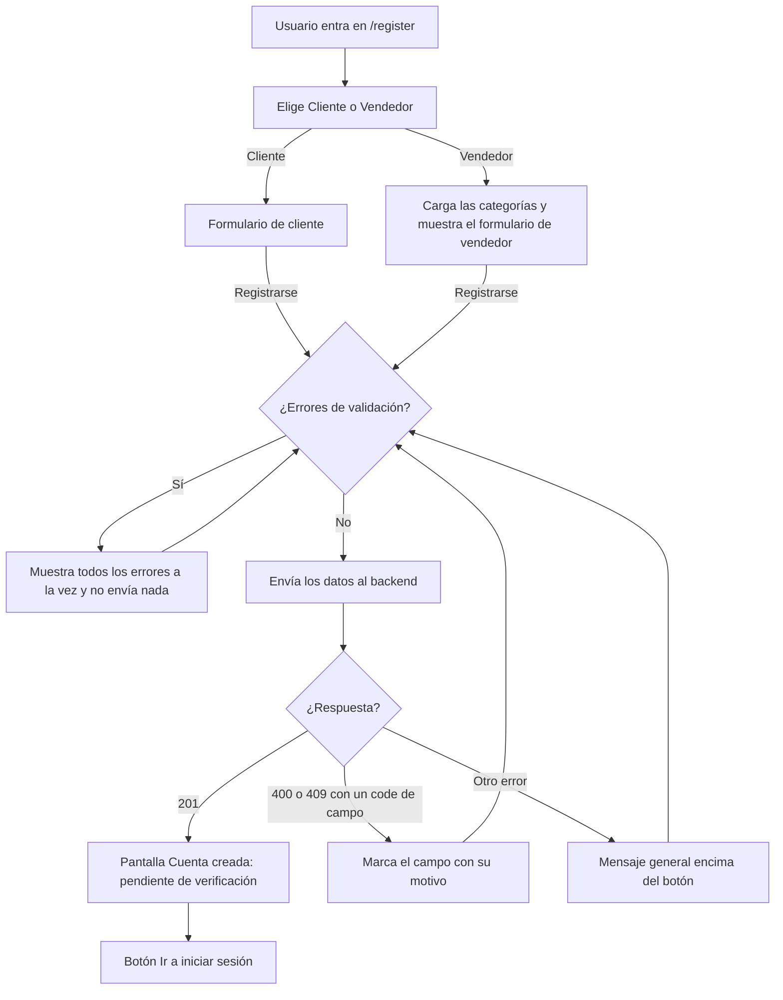

# HU1 · Registro de cliente y vendedor (Frontend)

Documento para entender la pantalla de registro: qué pide a cada tipo de usuario, cómo valida los datos, qué hace cada parte del código, qué contrato espera del backend y cómo probarlo.

- **Fecha:** 8 de octubre de 2026
- **HU:** HU1 · Registrar usuario
- **Tasks:** AB#17 y AB#18; después, AB#234 (cuenta pendiente tras el registro) y AB#242 (password solo escrito a mano)
- **Rama:** `feature/front/registro`; la task AB#234, en `feature/US1-T234-cuenta-pendiente`; la task AB#242, en `feature/US1-T242-bloquear-pegar-contrasena-registro`
- **Metodología:** TDD. Cada ciclo tiene su commit de rojo (`test(HU1)`) y su commit de verde (`feat(HU1)`), y los refactors van en commits `refactor(HU1)` aparte.
- **Depende de:** `docs/Contexto_frontend.md` (sección 6.3, requisitos del registro) y `docs/mocks-msw.md` (mocks)
- **Ampliado por la task AB#234:** la cuenta creada queda **pendiente** hasta que un administrador la verifica. Ver la sección 1.1.

---

## 1. Resumen

En `/register` el usuario elige si quiere una cuenta de **cliente** o de **vendedor** y rellena el formulario correspondiente. Al pulsar **Registrarse** se validan todos los campos y se muestran **todos los errores a la vez**, no campo a campo. Si no hay errores, se envían los datos y aparece la pantalla **Cuenta creada**, que avisa de que la cuenta queda **pendiente** hasta que un administrador la verifique.

| Campo | Cliente | Vendedor | Reglas |
|---|---|---|---|
| Nombre | Obligatorio | Obligatorio | Máximo 30 caracteres |
| Apellidos | Obligatorio | Obligatorio | Máximo 30 caracteres |
| Fecha de nacimiento | Obligatorio | — | Mayor de 18 años |
| Nombre comercial | — | Obligatorio | Máximo 30 caracteres. Único |
| Categoría | — | Obligatorio | **Una sola** (se elige con botones de opción); un vendedor no tiene categorías secundarias |
| DNI | Obligatorio | Obligatorio | 8 números y una letra |
| Email | Obligatorio | Obligatorio | Formato válido, máximo 100 caracteres. Único |
| Teléfono | Opcional | Opcional | Si se rellena: 9 números, sin letras |
| Password | Obligatorio | Obligatorio | Mínimo 8 caracteres, con mayúscula, minúscula, número y símbolo. Máximo 64 |
| Repetir password | Obligatorio | Obligatorio | Igual que el password |
| Tipo de cliente | Obligatorio | — | Normal (por defecto) o Premium |
| Imagen de perfil | Opcional | Opcional | Uno de los tres avatares |
| Política de privacidad | Obligatorio | Obligatorio | Casilla "Acepto la política de privacidad" (RGPD) |

Los campos obligatorios llevan el asterisco rojo de Fluent UI.

> Las validaciones del frontend son **experiencia de usuario**. La unicidad del email y del nombre comercial solo la puede garantizar el backend, y el backend debe volver a validar todos los datos.

### 1.1 Cuenta pendiente de verificación (task AB#234)

El equipo decidió que **toda cuenta nueva**, de cliente o de vendedor, nace en estado **pendiente** (los administradores no: los da de alta otro administrador, HU22) y no puede iniciar sesión hasta que un administrador la active. Antes solo los vendedores pasaban por ese estado. La pantalla de confirmación dice ahora:

> Tu cuenta se ha creado correctamente y está pendiente de que un administrador la verifique. Podrás iniciar sesión cuando esté activada.

Para que el administrador pueda aceptar esas cuentas, la misma task completa los listados de la HU24 (se dejó aquí para que la corrección quedara junta en una sola task):

| Dónde | Cambio |
|---|---|
| Listado de clientes | El filtro de estado incluye **Pendiente**, y al ordenar por estado salen primero los pendientes, como en vendedores (los administradores ya no tienen ese estado: HU22) |
| Ficha de un cliente (HU20) | Si la cuenta está pendiente ofrece **Activar** (y no **Desactivar**), como con los vendedores pendientes |
| Mock de usuarios | Dos clientes pendientes (Gonzalo Ibáñez Roca y Marcos Aguilar Bravo) (el administrador pendiente Manuel Esteve Pons pasó a activo con la HU22: los administradores no están pendientes). **Crear administrador** (HU21) sigue creándolos activos |

En el backend, otra task de la HU1 hace que `Usuario` nazca en `PENDIENTE` y que esa cuenta no cuente como activa. Los documentos de la HU19, la HU20, la HU23 y la HU24 están actualizados.

### 1.2 Fallos de la demo del Sprint 1

En la demo del Sprint 1 se vieron tres fallos del registro, corregidos con TDD en la rama `fix/sprint1-demo-frontend`:

| Fallo | Corrección |
|---|---|
| Cuando el backend rechazaba los datos (por ejemplo, una contraseña con el nombre o un DNI repetido), el formulario no decía por qué, o marcaba el email aunque el problema fuera el DNI | El backend indica el motivo con un `code` (PR #104) y `features/account/registroErrors.js` lo traduce al campo que hay que marcar y a su mensaje (sección 5). Si el error no tiene campo, aparece un mensaje general encima del botón **Registrarse** |
| Tras registrarse no había forma de ir al login | La pantalla **Cuenta creada** tiene un botón **Ir a iniciar sesión** |
| Con la sesión iniciada, la home seguía ofreciendo **Crear mi cuenta** y `/register` mostraba el formulario | La home solo muestra **Crear mi cuenta** sin sesión, y `/register` lleva a la página de inicio del rol (`auth/GuestOnlyRoute.jsx`) |
| Contra el backend real, un registro correcto mostraba «No se ha podido completar la operación» aunque la cuenta se creaba | El backend responde **201 sin cuerpo** y `api/client.js` lo leía como JSON. Ahora una respuesta sin cuerpo devuelve `null`. El mock del registro responde igual que el backend, para que no vuelva a esconder la diferencia |

`registroErrors.js` lo comparten el registro, el alta de administrador (HU21) y la edición de usuarios (HU22), para que los tres formularios traduzcan los errores igual.

### 1.3 Password solo escrito a mano (task AB#242)

En el formulario de registro, tanto de cliente como de vendedor, **Password** y **Repetir password** no admiten copiar, cortar, pegar ni soltar texto arrastrado. Así el usuario tiene que escribir la contraseña **a mano dos veces** y no puede dar por buena una errata pegándola en los dos campos. Tampoco se puede copiar con el ojo activado (password visible).

- **Cómo:** `PasswordField` tiene una propiedad nueva `bloquearPegado` (desactivada por defecto) que cancela los eventos `copy`, `cut`, `paste` y `drop` del campo. `Register.jsx` la activa en los dos campos de password.
- **Solo en el registro:** el login (`CredentialsStep`) y el alta de administradores (`AdminNewAdminPage`) usan el mismo componente, pero no la activan. En el login hay que poder pegar la contraseña de un gestor de contraseñas.
- **No es una barrera de seguridad:** es una ayuda de usabilidad. Se puede saltar, por ejemplo con las herramientas del navegador. La política de password y su validación en el backend no cambian.

---

## 2. Flujo



Mientras se escribe el password, la lista de requisitos marca con un tick verde cada uno que se cumple. Cada campo de password tiene un botón con un ojo para mostrarlo u ocultarlo, y ninguno admite pegar ni copiar (sección 1.3).

---

## 3. Componentes y archivos

Todas las rutas son relativas a `frontend/src/`.

### Página

| Archivo | Qué hace |
|---|---|
| `pages/Register.jsx` | Toda la pantalla: elección del tipo de cuenta, los dos formularios, la validación, el envío y la confirmación. |
| `routes/AppRoutes.jsx` | Ruta `REGISTER` (`/register`) dentro de `AppLayout`, solo para quien no tiene sesión (`GuestOnlyRoute`). |
| `auth/GuestOnlyRoute.jsx` | Si hay sesión, lleva a la página de inicio del rol; si no, muestra la ruta. Mientras se comprueba la sesión, un indicador de carga. |
| `pages/Home.jsx` | Solo ofrece **Crear mi cuenta** a quien no tiene sesión. |
| `features/account/registroErrors.js` | `erroresDelServidor(error)`: traduce el `code` de un 400 o 409 al campo y su mensaje (`{ campos }`) o da un mensaje general (`{ general }`). Lo usan también la HU21 y la HU22. |

### Organización de `Register.jsx`

| Parte | Qué hace |
|---|---|
| `OBLIGATORIOS_CLIENTE` / `OBLIGATORIOS_VENDEDOR` | Campos obligatorios de cada formulario. |
| `REQUISITOS_PASSWORD` | Las cinco reglas del password (texto y comprobación). La misma lista sirve para pintar los ticks y para validar al enviar. Admite letras con acento y la ñ. |
| `LONGITUD_MAXIMA` | Máximo de caracteres de cada campo. Se aplica con `maxLength`, así que no se puede escribir de más. |
| `AVATARES` | Los tres avatares: un `Avatar` de Fluent con un icono de animal (gato, perro y conejo) y su color. |
| `validarCamposComunes()` | Valida lo que comparten los dos formularios: obligatorios, DNI, email, teléfono, requisitos del password, que los dos passwords coincidan y la política de privacidad. |
| `enviarCliente()` / `enviarVendedor()` | Añaden su validación propia (mayoría de edad o categoría), envían los datos y muestran los errores del backend con `erroresDelServidor`. |
| `campo()`, `campoPassword()`, `camposComunes`, `selectorAvatar`, `casillaPrivacidad` | Piezas de la interfaz que comparten los dos formularios, para no repetir código. |
| `pantalla()` | Tarjeta centrada con su título, común a las cuatro pantallas (elección, cliente, vendedor y confirmación). |

### API y mocks

| Archivo | Qué hace |
|---|---|
| `api/auth.js` | `registrarCliente(datos)` y `registrarVendedor(datos)`. |
| `api/products.js` | `getCategories()`, compartida con el listado de productos del vendedor (HU32). |
| `mocks/registroHandlers.js` | Simula los dos endpoints de registro: crea la cuenta (201 sin cuerpo, como el backend) o responde 409 si el email o el nombre comercial ya existen. Nunca guarda el password. |
| `mocks/authHandlers.js` | Exporta `USUARIOS` para que el mock del registro sepa qué emails ya existen. |
| `mocks/handlers.js` | Registra los handlers del registro. |

---

## 4. Seguridad

- **Política de password** visible desde el principio, con un tick por requisito cumplido. Al enviar se rechaza cualquier password que no cumpla las cinco reglas.
- **El password solo se escribe a mano** en el registro, también al repetirlo: los campos bloquean copiar, cortar, pegar y soltar texto (sección 1.3).
- **El password nunca se guarda en el navegador** (ni en `localStorage` ni en `sessionStorage`). El mock tampoco lo guarda: solo recuerda emails y nombres comerciales para detectar duplicados.
- **Límite de longitud** en los campos de texto, para no enviar entradas desproporcionadas.
- **Consentimiento RGPD** obligatorio para registrarse.
- **Mensajes de duplicado** solo para el email y el nombre comercial, que son los datos que el usuario necesita corregir.

---

## 5. Contrato esperado del backend

**El frontend se ha desarrollado y probado con mocks (MSW)**, porque el backend aún no estaba disponible. Las rutas, el cuerpo de la petición y los códigos de error de esta sección los ha definido el frontend, así que **puede haber diferencias con el backend real**. Se ajustarán cuando se unan frontend y backend.

`POST /api/auth/register/cliente` y `POST /api/auth/register/vendedor`

Cuerpo (JSON): el objeto completo del formulario.

```json
{
  "nombre": "Luis",
  "apellidos": "Pérez",
  "nombreComercial": "Tienda Luis",
  "categoriaPrincipalId": "cat-1",
  "fechaNacimiento": "",
  "dni": "12345678Z",
  "email": "luis@correo.com",
  "telefono": "612345678",
  "password": "Password123!",
  "repeticionPassword": "Password123!",
  "tipoCliente": "ESTANDAR",
  "avatar": "avatar2",
  "aceptaPrivacidad": true
}
```

| Respuesta | Significado para el frontend |
|---|---|
| 201 (sin cuerpo) | Cuenta creada: se muestra la confirmación. La cuenta queda en `PENDIENTE` hasta que un administrador la active (task AB#234) |
| 409 + `{ "code": "EMAIL_ALREADY_REGISTERED" }` | "Este email ya está registrado" |
| 409 + `{ "code": "DNI_ALREADY_REGISTERED" }` | "Este DNI ya está registrado" |
| 409 + `{ "code": "COMMERCIAL_NAME_ALREADY_REGISTERED" }` | "Este nombre comercial ya está registrado" (solo vendedor) |
| 409 + `{ "code": "EMAIL_AND_COMMERCIAL_NAME_ALREADY_REGISTERED" }` | Los dos mensajes (solo vendedor) |
| 400 + `{ "code": "PASSWORD_TOO_SHORT" }`, `PASSWORD_TOO_LONG`, `PASSWORD_WEAK`, `PASSWORD_TOO_COMMON` o `PASSWORD_CONTAINS_PERSONAL_DATA` | Mensaje con el motivo en el campo **Password** |
| 400 + `{ "code": "PASSWORDS_DO_NOT_MATCH" }` | "Las contraseñas no coinciden" en **Repetir password** |
| 400 + `{ "code": "INVALID_EMAIL" }`, `INVALID_DNI`, `INVALID_PHONE`, `UNDERAGE` o `PRIVACY_NOT_ACCEPTED` | Mensaje en el email, el DNI, el teléfono, la fecha de nacimiento o la casilla de privacidad |
| 400 con otro `code` (por ejemplo, `VALIDATION_ERROR`) | "Revisa los datos del formulario", encima del botón |
| Cualquier otro error (5xx, sin conexión...) | "No se ha podido completar la operación. Inténtalo de nuevo más tarde", encima del botón |

- Los códigos los añadió el backend en el PR #104 (fallos de la demo del Sprint 1). La traducción está en `features/account/registroErrors.js`; el texto del error del backend nunca se muestra.
- `tipoCliente` usa los valores del enum del backend: `ESTANDAR` (por defecto) o `PREMIUM`. Con otro valor (antes se enviaba `normal` o `premium`) el backend responde 400 sin llegar al registro.
- `telefono` es opcional: si está vacío, **no se envía**. El backend solo lo trata como ausente si no llega; un texto vacío lo rechaza como teléfono inválido.
- `categoriaPrincipalId` envía **un solo identificador**, de los que devuelve `GET /api/categorias` (decisión del equipo: un vendedor tiene una única categoría). Antes se enviaba `categorias`, una lista; el nombre del campo se ha tomado del que ya usan la edición del vendedor y el esquema de la base de datos, y hay que acordarlo con el backend.
- Se envían también campos que el backend no necesita (`repeticionPassword`, y los del otro tipo de usuario vacíos). Se filtrarán al unir con el backend.

---

## 6. Datos de prueba y cómo verlo en el navegador

Con `npm run dev` (mocks activos con `VITE_USE_MOCKS=true` en `.env.development`):

| Prueba | Resultado |
|---|---|
| Cliente o vendedor con un email nuevo | Pantalla **Cuenta creada**, con el aviso de que queda pendiente de verificación |
| Email `cliente@esibuy.test`, `vendedor@esibuy.test` o cualquier otro usuario del mock de login | "Este email ya está registrado" |
| Vendedor con nombre comercial `Tienda Vera` | "Este nombre comercial ya está registrado" |
| Las dos cosas a la vez | Los dos mensajes |
| Registrar dos veces el mismo email nuevo | La segunda vez, "ya está registrado" (el mock lo recuerda hasta recargar la página) |

Pruebas manuales sugeridas:

1. Pulsar **Registrarse** con el formulario vacío y comprobar que aparecen todos los errores a la vez.
2. Escribir un password poco a poco y ver cómo se marcan los requisitos.
3. Pulsar el ojo de cada password para mostrarlo y ocultarlo.
   Intentar pegar (Ctrl+V) un texto en **Password** y en **Repetir password**: no aparece nada. Con el password visible, intentar copiarlo (Ctrl+C): no se copia.
4. Como vendedor, elegir una categoría: al elegir otra, la anterior se desmarca.
5. Intentar escribir más de 30 caracteres en el nombre.

### Tests automáticos

```bash
npx vitest run     # 129 tests (47 son de esta HU)
npm run lint
npm run build
```

| Archivo | Qué cubre |
|---|---|
| `pages/Register.test.jsx` | 47 tests: elección del tipo de cuenta, campos y obligatoriedad de cada formulario, categorías, avatares, validaciones (DNI, email, teléfono, mayoría de edad, requisitos y coincidencia del password, longitud máxima, política de privacidad), mostrar u ocultar el password, envío, confirmación y errores 409. |

Los tests sustituyen `api/auth` y `api/products` con `vi.mock`, así que no dependen de los mocks de MSW.

**Fallos de la demo del Sprint 1** (con TDD; casos HU1-CP23 a CP26 de la matriz):

| Archivo | Tests | Qué cubre |
|---|---|---|
| `features/account/registroErrors.test.js` (nuevo) | 3 | Cada `code` va a su campo; un `code` sin campo da el mensaje general; un error que no es de los datos da el mensaje de error del servidor |
| `pages/Register.test.jsx` | 5 nuevos y 1 cambiado | Contraseña con datos personales, DNI repetido en cliente y en vendedor, error sin campo y botón **Ir a iniciar sesión**. El test del email repetido ahora envía su `code` |
| `pages/Home.test.jsx` | 1 nuevo | Con la sesión iniciada no se ofrece **Crear mi cuenta** |
| `auth/GuestOnlyRoute.test.jsx` (nuevo) | 2 | Con sesión, `/register` lleva a la página del rol; sin sesión, muestra el formulario |
| `api/client.test.js` | 1 nuevo | Una respuesta 201 sin cuerpo devuelve `null` en lugar de un error |

**Task AB#242** (con TDD; caso HU1-CP27 de la matriz):

| Archivo | Tests | Qué cubre |
|---|---|---|
| `features/account/PasswordField.test.jsx` | 4 nuevos | Con `bloquearPegado` no se puede pegar, copiar, cortar ni soltar texto (tampoco con el password visible); sin él, como en el login, sí se puede pegar |
| `pages/Register.test.jsx` | 3 nuevos | En cliente y en vendedor no se puede pegar ni el password ni su repetición; escrito a mano en los dos campos, el registro sigue funcionando |

**Task AB#234** (con TDD: primero los tests en rojo y después el código):

| Archivo | Tests | Qué cubre |
|---|---|---|
| `pages/Register.test.jsx` | 2 nuevos | La confirmación del cliente y la del vendedor avisan de que la cuenta queda pendiente de verificación |
| `features/admin/RoleUsersList.test.jsx` | 1 nuevo y 3 cambiados | El filtro ofrece Pendiente, filtrar por Pendiente, los pendientes primero al ordenar por estado y el total de clientes (17) |
| `features/admin/UserDetailDialog.test.jsx` | 2 nuevos | La ficha de una cuenta pendiente ofrece Activar y no Desactivar, y activarla la deja activa |
| `pages/AdminUsersPage.test.jsx` (HU19) y `pages/AdminAdminsPage.test.jsx` (HU21) | Recuentos | 28 usuarios, 5 pendientes y 4 administradores con los datos nuevos del mock |

---

## 7. Decisiones

- **Convención de nombres:** en la interfaz se usan "Email" y "Password", acordado en una reunión del equipo para todo el proyecto.
- **Categoría con botones de opción** (`RadioGroup` dentro de un `fieldset`) y no con un desplegable: solo se puede elegir una y las opciones son pocas, así que se ven todas. Antes eran casillas con selección múltiple; se cambió cuando el equipo decidió que vendedores y productos tienen una única categoría.
- **Límite de longitud con `maxLength`:** se impide escribir de más en lugar de dejarlo y mostrar un error después.
- **Códigos de error 400 y 409** con el campo `code`, siguiendo el patrón del login (`ACCOUNT_DISABLED`) y sin tocar `api/client.js`. La traducción vive en un módulo aparte (`registroErrors.js`) porque la necesitan tres formularios.
- **Botón para ir al login, sin redirección automática** tras registrarse: la cuenta queda pendiente y el usuario tiene que leer el aviso antes de seguir.
- **Avatares con iconos de Fluent UI**, sin imágenes externas. Para cambiarlos basta con editar la lista `AVATARES`.
- **Cuenta pendiente tras el registro (task AB#234):** decisión del equipo. Las cuentas pendientes de clientes y administradores se aceptan con **Activar** desde su ficha, igual que los vendedores. El administrador pendiente del mock solo sirve para probar el filtro: **Crear administrador** sigue creándolos activos.
- **No se ha añadido ninguna librería nueva.** Todo sale de `@fluentui/react-components`, `@fluentui/react-icons` y `react-router-dom`.

## 8. Limitaciones y trabajo pendiente

- **Cliente Premium:** no redirige al pago. Es un punto abierto de `Contexto_frontend.md` y depende de las HU de pagos, fuera de este sprint.
- **Subir una imagen de perfil propia:** no está hecho; de momento solo se elige uno de los tres avatares.
- **Fallo al cargar las categorías:** no se muestra ningún mensaje. `DESIGN.md` recomienda un `MessageBar` de error con **Reintentar**.
- **Diferencias menores con `DESIGN.md`:** el error de categorías es un texto propio en lugar del mensaje de `Field`, y los ticks del password usan el verde de Fluent aplicado directamente.
- **Unión con el backend:** ajustar rutas y cuerpo (sección 5). Los códigos de error ya coinciden con los del backend (PR #104).

---

## 9. Uso de IA generativa

Este documento y el trabajo técnico que describe se hicieron con ayuda de un asistente de IA generativa, como exige el enunciado.

- **Herramienta:** Claude (modelo de Anthropic), mediante Claude Code.
- **Qué generó la IA:** los tests y el código de cada ciclo de TDD, los refactors, los mocks del registro y este documento.
- **Qué hizo el equipo:** definió los requisitos de cada campo (obligatoriedad, longitudes, formato del teléfono, reglas del password), decidió la convención Email/Password, el formato de las categorías, los códigos de error y el estilo. Aprobó cada ciclo antes de pasar al siguiente e hizo cada commit.
- **Cómo se comprobó:** en cada ciclo se ejecutaron los tests (129 en verde al final), ESLint sin errores y el build de producción. La pantalla se revisó en el navegador con los mocks.
- **Qué NO se comprobó:** el flujo contra un backend real. El contrato de la sección 5 debe acordarse con el backend.
- **Task AB#234:** la IA escribió los tests, el código, los datos del mock y los cambios en la documentación, e hizo los commits a petición del equipo. El equipo decidió que toda cuenta nueva quede pendiente, el texto de la pantalla, que la ficha ofrezca Activar como en vendedores y que el administrador pendiente sea solo un dato del mock. Se comprobó con los tests (los archivos afectados, en verde), ESLint y el build.
- **Fallos de la demo del Sprint 1:** la IA escribió los tests y el código de cada ciclo, y los cambios en este documento. El equipo decidió qué fallos se corregían, que fueran en una rama `fix` sin tasks nuevas y que tras el registro hubiera un botón y no una redirección. Se comprobó con la suite completa (592 tests en verde), ESLint y el build.
- **Revisión humana:** el código fue revisado, ejecutado y validado por el equipo antes de su integración. Revisado por: Alejandro.
