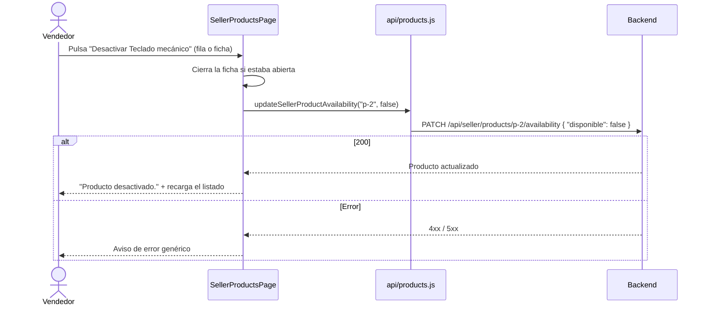

# HU16 · Activar y desactivar productos (Frontend)

Documento para entender cómo activa y desactiva el vendedor sus productos: dónde están los botones, qué contrato espera del backend y cómo probarlo.

- **Fecha:** 27 de octubre de 2026
- **HU:** HU16 · Activación y desactivación de productos
- **Task:** AB#281 · Frontend: botón activar/desactivar productos
- **Rama:** `feature/US16-T281-activar-desactivar-productos`
- **Metodología:** sin TDD (no es obligatorio en esta HU); los tests se escribieron junto a la implementación
- **Depende de:** `docs/hu32-listado-productos.md` (listado) y `docs/mocks-msw.md` (mocks)

> **Versión inicial.** Los botones funcionan de principio a fin con los mocks, pero el comportamiento (sin confirmación, textos, contrato) puede cambiar por decisión del PO o del equipo.

---

## 1. Resumen

Activar o desactivar un producto cambia su campo `disponible`, el mismo que la tabla muestra como **Disponible** / **No disponible**. Solo los productos disponibles aparecen en el catálogo del cliente (HU7).

| Decisión | Detalle |
|---|---|
| Dónde está el botón | En cada fila de **Mis productos** (icono, junto a Ver, Editar y Eliminar) y en la ficha del producto (junto a Editar y Eliminar). |
| Qué ofrece | Un producto disponible ofrece **Desactivar**; uno no disponible, **Activar**. El nombre accesible incluye el del producto: "Desactivar Teclado mecánico". |
| Confirmación | **Ninguna** (decisión del equipo, por ahora): el cambio no borra nada y se deshace con otro clic. |
| Resultado | Aviso "Producto activado." o "Producto desactivado." y el listado se vuelve a cargar. Desde la ficha, la ficha se cierra. |
| Error | Aviso "No se ha podido cambiar la disponibilidad del producto. Inténtalo de nuevo.", sin detalles internos. El producto no cambia. |

---

## 2. Flujo



---

## 3. Componentes y archivos

| Archivo | Cambio |
|---|---|
| `src/api/products.js` | Nueva `updateSellerProductAvailability(productId, disponible)`. |
| `src/features/seller/ProductRowActions.jsx` | Botón Activar/Desactivar; nueva prop `onToggleAvailability(product)`. |
| `src/features/seller/ProductDetailDialog.jsx` | Botón Activar/Desactivar en las acciones de la ficha; nueva prop `onToggleAvailability(product)`. |
| `src/pages/SellerProductsPage.jsx` | `toggleAvailability`: llama a la API, avisa y recarga. El aviso pasa a ser `{ intent, text }` para poder mostrar también errores. |
| `src/mocks/productsHandlers.js` | Handler del `PATCH`, `resetProductsMock()` y `estaDisponible(producto)`, que usan el catálogo, su detalle y el carrito. |
| `src/mocks/cartHandlers.js` | Usa `estaDisponible` para saber si un producto se puede añadir al carrito. |
| `src/test/setup.js` | Llama a `resetProductsMock()` después de cada test. |

La fila y la ficha no llaman a la API: avisan a la página con el producto, como hace Eliminar.

---

## 4. Contrato con el backend

El contrato lo propuso el frontend y el backend lo implementa tal cual: la lógica en las tasks T284 y T285 (PR #171) y el endpoint en las T282 y T283. Activar y desactivar son el mismo endpoint con un booleano.

```
PATCH /api/seller/products/{id}/availability
Content-Type: application/json

{ "disponible": true | false }
```

| Respuesta | Cuándo |
|---|---|
| `200` con el producto actualizado (mismo formato que `GET /api/seller/products/{id}`) | Cambio correcto. |
| `400` con `VALIDATION_ERROR` | Falta `disponible`, es `null` o no es un booleano de verdad: `"abc"`, `"true"` (texto) o `1` no valen. También un JSON mal formado. El mensaje es genérico: "Los datos enviados no son válidos". |
| `401` / `403` | Sin sesión, sin ser vendedor o sin token CSRF. |
| `404` con `PRODUCT_NOT_FOUND` | El producto no existe o es de otro vendedor (como en el resto de endpoints del vendedor). |

Pedir el estado que el producto ya tiene no es un error: responde `200` con el producto igual. El frontend no depende del código del `400`: ante cualquier error muestra el mismo aviso genérico.

---

## 5. Mocks

Las escrituras de productos no cambian los datos de ejemplo, **salvo esta**: la disponibilidad cambiada se guarda durante la sesión para que el listado, la ficha, el catálogo del cliente, el detalle de un producto del catálogo (HU8) y el carrito (HU9) la reflejen: un producto desactivado deja de verse en el catálogo y no se puede añadir al carrito. `resetProductsMock()` la deshace entre tests. Para probarlo con `npm run dev`: entra como `vendedor@esibuy.test` y usa **Webcam Full HD** (no disponible) o cualquier otro producto (disponible).

---

## 6. Tests

| Caso | Test | Archivo |
|---|---|---|
| HU16-CP01 | Un producto disponible ofrece Desactivar y uno no disponible, Activar | `SellerProductsPage.test.jsx` |
| HU16-CP02 | Desactivar, sin confirmación, deja el producto no disponible y avisa | `SellerProductsPage.test.jsx` |
| HU16-CP03 | Activar deja el producto disponible y avisa | `SellerProductsPage.test.jsx` |
| HU16-CP04 | Si falla, avisa sin detalles internos y el producto no cambia | `SellerProductsPage.test.jsx` |
| HU16-CP05 | La ficha ofrece Activar o Desactivar según el estado y avisa con el producto (2 tests) | `ProductDetailDialog.test.jsx` |
| HU16-CP06 | Desde la ficha, Desactivar cierra la ficha, cambia el producto y avisa | `SellerProductsPage.test.jsx` |
