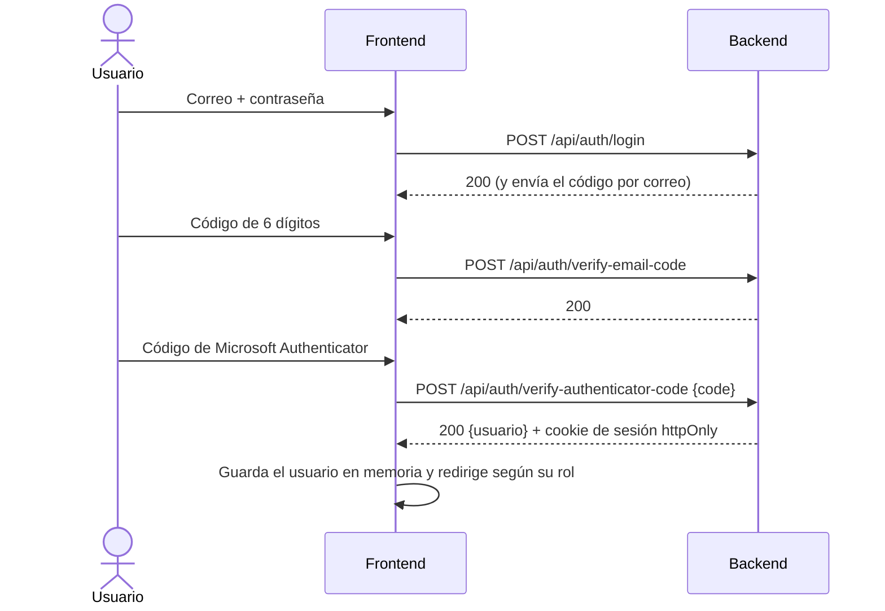
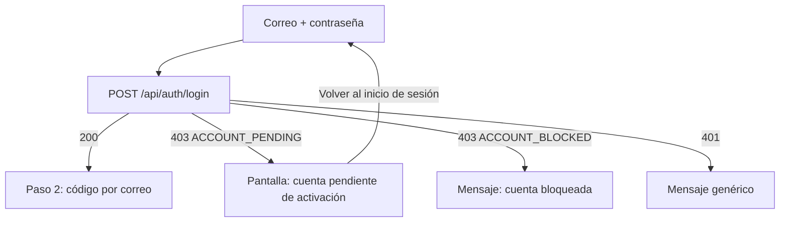

# HU2 · Inicio de sesión seguro y redirección por rol (Frontend)

Documento para entender cómo funciona el login del frontend de ESIBuy: qué hace cada componente, cuál es el flujo, qué contrato espera del backend y cómo probarlo.

- **Fecha:** 7 de octubre de 2026
- **HU:** HU2 (inicio de sesión seguro) y la parte de redirección por rol de HU15 y HU18
- **Rama:** `feature/front/login`
- **Metodología:** esta HU **no se desarrolló con TDD**; los tests se añadieron después
- **Ampliada por la task AB#236** (rama `feature/US2-T236-mensaje-cuenta-pendiente-login`): pantalla animada para las cuentas pendientes de activación. Ver la sección 2.1.
- **Ampliada por la task AB#245** (Sprint 2, rama `feature/US2-T245-mensaje-cuenta-bloqueada-antes-del-2fa`): las cuentas ya no se desactivan, se bloquean. El login muestra el mensaje de cuenta bloqueada antes del código del correo. Ver la sección 2.2.
- **Depende de:** `docs/mocks-msw.md` (MSW y cliente HTTP)

---

## 1. Resumen

El usuario inicia sesión en **tres pasos**:

| Paso | Factor | Qué introduce el usuario |
|---|---|---|
| 1 | Credenciales | Correo electrónico y contraseña |
| 2 | Código por correo (2FA) | Código de 6 dígitos que el backend envía a su correo |
| 3 | Microsoft Authenticator (3FA) | Código de 6 dígitos (TOTP) que genera la aplicación Microsoft Authenticator |

Al completar el tercer paso el backend abre la sesión y el frontend redirige al usuario según su rol. Una vez iniciada la sesión, la cabecera sustituye los botones "Iniciar sesión" y "Registrarse" por "Cerrar sesión".

> **Cambio respecto al diseño anterior.** El tercer factor era un captcha de Google. Se sustituye por un código TOTP de Microsoft Authenticator, que sí comprueba que quien accede posee un dispositivo registrado (un captcha solo comprueba que es una persona). Se elimina la dependencia `react-google-recaptcha`.

---

## 2. Flujo



### 2.1 Cuenta pendiente de activación (task AB#236)

Las cuentas de clientes y vendedores nacen **pendientes** (HU1) y no pueden iniciar sesión hasta que un administrador las activa. Si alguien intenta entrar con una cuenta así, **justo después de pulsar "Continuar" en el paso 1** el formulario se sustituye por una pantalla que se lo explica, en lugar de un mensaje de error.



La pantalla (`PendingAccountScreen`):

- **Es dinámica:** nombra la cuenta que se ha intentado usar (el correo que escribió el usuario) y muestra en qué punto está: *Cuenta creada* (hecho) → *Verificación por un administrador* (en curso) → *Acceso a ESIBuy* (pendiente).
- **Es animada:** aparece con un fundido y un desplazamiento suaves, el icono tiene un aro que pulsa, los tres pasos entran uno tras otro y el icono del paso en curso se mueve. Con la preferencia del sistema *reducir movimiento* (`prefers-reduced-motion`) **todas las animaciones se desactivan**.
- **Es accesible:** el título recibe el foco al aparecer y la región se anuncia con `aria-live="polite"`. Los iconos son decorativos.
- **Tiene una única salida:** "Volver al inicio de sesión", que devuelve el formulario **vacío** (la contraseña ya se vació al enviarse).
- **No se dejan pasar los pasos 2 y 3:** el backend no envía ningún código a una cuenta pendiente.

> **Seguridad.** Para no revelar qué correos existen, el backend solo debe responder `ACCOUNT_PENDING` **cuando la contraseña es correcta**, igual que con `ACCOUNT_BLOCKED`. Con contraseña errónea, una cuenta pendiente da el mismo mensaje genérico que cualquier otra (hay un test).

### 2.2 Cuenta bloqueada por un administrador (task AB#245, Sprint 2)

Desde el Sprint 2 las cuentas **no se desactivan, se bloquean** (decisión del equipo). En el login, una cuenta bloqueada por un administrador se rechaza **en el paso 1**, igual que una cuenta pendiente: el usuario ve el mensaje antes del código del correo y el backend no envía ningún código.

| Respuesta del backend | Qué ve el usuario |
|---|---|
| `403` con `{ "code": "ACCOUNT_BLOCKED" }` | Barra de error: *"Esta cuenta está bloqueada. Contacta con un administrador."* |
| `429` (demasiados intentos fallidos, bloqueo temporal de 15 minutos) | Barra de error: *"Demasiados intentos. Espera unos minutos antes de volver a intentarlo."* |

Son dos causas distintas con dos mensajes distintos: el bloqueo por un administrador no caduca solo; el de intentos sí.

- **El frontend ya no espera `ACCOUNT_DISABLED`.** Si el backend siguiera enviándolo, el usuario vería el mensaje genérico de credenciales.
- **Solo cambia el login.** El resto de pantallas (botones *Desactivar*, etiquetas de estado de los listados, diálogos y los documentos de la HU23, HU24 y similares) se renombran en otras tasks del Sprint 2.

### Redirección por rol

| Rol (valor del backend) | Destino | Página |
|---|---|---|
| `ADMINISTRADOR` | `/admin` | `AdminPage` |
| `CLIENTE` | `/products` | `ProductsPage` |
| `VENDEDOR` | `/seller/products` | `SellerProductsPage` |
| Rol desconocido | `/` | Home |

Las tres páginas existen pero **no pintan nada**: son un componente que devuelve `null`, preparadas para que se implementen en sus historias (HU15, HU18 y el catálogo). Un archivo `.jsx` totalmente vacío no se puede importar como componente, por eso tienen esa única función.

### Reglas de acceso

| Ruta | Quién entra | Si no cumple |
|---|---|---|
| `/`, `/products` | Cualquiera | |
| `/login` | Solo sin sesión | Con sesión, redirige al destino de su rol |
| `/admin` | Administrador | Sin sesión → `/login`; otro rol → destino de su rol |
| `/seller/products` | Vendedor | Sin sesión → `/login`; otro rol → destino de su rol |

> Estas restricciones son **solo experiencia de usuario**. La barrera real de seguridad es el backend, que debe responder 401 o 403 igualmente.

### Cerrar sesión

1. El usuario pulsa "Cerrar sesión" en la cabecera.
2. El frontend navega a la home y llama a `POST /api/auth/logout`.
3. Aunque esa llamada falle, la sesión local se limpia (la cookie del servidor caducará por sí sola).
4. La cabecera vuelve a mostrar "Iniciar sesión" y "Registrarse".

---

## 3. Componentes y archivos

Todas las rutas son relativas a `frontend/src/`.

### Autenticación y sesión (`auth/`)

| Archivo | Qué hace |
|---|---|
| `AuthContext.js` | Crea el contexto de React que comparte la sesión. |
| `AuthProvider.jsx` | Al cargar la app consulta `GET /api/auth/me` para recuperar la sesión desde la cookie. Expone `user`, `loading`, `signIn` y `signOut`. El usuario vive **solo en memoria**. |
| `useAuth.js` | Hook para leer la sesión. Lanza un error si se usa fuera de `AuthProvider`. |
| `ProtectedRoute.jsx` | Protege rutas por rol (`allowedRoles`). Muestra un indicador mientras comprueba la sesión. |
| `roles.js` | Constantes de rol y función `getHomePath(rol)` con el destino de cada uno. Usa un `Map`, de modo que un rol inesperado nunca devuelve algo no previsto. |

### Formulario de login (`features/auth/`)

| Archivo | Qué hace |
|---|---|
| `LoginForm.jsx` | Orquesta los tres pasos, controla el estado de envío y los errores. Solo avanza de paso cuando el backend responde bien. Si el backend indica cuenta pendiente, muestra `PendingAccountScreen`. |
| `CredentialsStep.jsx` | Paso 1. Valida que haya correo y contraseña (todos los errores a la vez) y **vacía la contraseña del estado en cuanto se envía**. La contraseña usa `PasswordField` (de `features/account/`, el mismo del registro), con un botón para mostrarla u ocultarla; aquí no se marca como obligatoria ni se muestran los requisitos, y se puede pegar la contraseña (el registro la bloquea, ver `hu1-registro.md`, sección 1.3). |
| `CodeStep.jsx` | Pasos 2 y 3. Campo de código de 6 dígitos (se reutiliza para el correo y para Microsoft Authenticator): solo admite números y vacía el valor al enviarlo. |
| `loginErrors.js` | Traduce los errores del backend a mensajes fijos para el usuario. `isPendingAccountError` detecta la cuenta pendiente, que no se muestra como mensaje sino con su propia pantalla. |
| `PendingAccountScreen.jsx` | Pantalla animada de "cuenta pendiente de activación" (task AB#236). Recibe el correo y la función para volver. |
| `authFormStyles.js` | Estilos compartidos de los formularios. |
| `LoginFlow.test.jsx` | Tests del flujo completo, los errores y las rutas protegidas. |

### Estructura de la interfaz (`components/` y `pages/`)

| Archivo | Qué hace |
|---|---|
| `components/AppHeader.jsx` | Cabecera con el logo. Sin sesión muestra "Iniciar sesión" y "Registrarse"; con sesión, "Cerrar sesión", más "Panel de control" si es administrador (HU18) o "Mis productos" si es vendedor (HU15, fallos de la demo del Sprint 1). Mientras se comprueba la sesión no muestra ningún botón, para evitar parpadeos. |
| `components/AppLayout.jsx` | Marco común: cabecera y contenido de la ruta. **La página de login queda fuera**, por lo que no lleva cabecera. |
| `components/AppHeader.test.jsx` | Tests de la cabecera. |
| `pages/LoginPage.jsx` | Página de login; redirige si ya hay sesión. |
| `pages/AdminPage.jsx`, `ProductsPage.jsx`, `SellerProductsPage.jsx` | Páginas de destino, vacías a propósito. |
| `pages/Home.jsx` | Se le ha quitado la cabecera (ahora la pone el layout). |
| `routes/paths.js` | Todas las rutas en un solo sitio, para no repetir cadenas. |
| `routes/AppRoutes.jsx` | Definición de rutas y protecciones. |

### API y mocks

| Archivo | Qué hace |
|---|---|
| `api/auth.js` | Funciones `getCurrentUser`, `login`, `verifyEmailCode`, `verifyAuthenticatorCode` y `logout`. |
| `api/client.js` | Ahora el error (`ApiError`) incluye `code`, un identificador que envía el backend. Nunca se muestra el texto del error del servidor. |
| `mocks/authHandlers.js` | Simula el backend de autenticación (ver sección 6). |
| `test/renderApp.jsx`, `test/LocationProbe.jsx` | Utilidades de test para pintar la app completa y comprobar la ruta actual. |

---

## 4. Seguridad

| Medida | Cómo se aplica |
|---|---|
| Sin almacenamiento del navegador | No se usa `localStorage` ni `sessionStorage`. La sesión va en una **cookie httpOnly** que gestiona el backend y que JavaScript no puede leer. Hay un test que comprueba que tras un login completo ambos están vacíos. |
| Mensajes genéricos | Contraseña errónea y usuario inexistente dan exactamente el mismo mensaje. Excepciones acordadas: cuenta bloqueada por un administrador (antes desactivada, HU23) y exceso de intentos. |
| No se muestran textos del servidor | Los mensajes salen de una tabla fija, así que un error interno nunca llega a la pantalla. |
| Higiene de datos sensibles | La contraseña y los códigos se vacían del estado al enviarse. Los campos usan `autocomplete` correcto (`current-password`, `one-time-code`). |
| El backend impone el orden | El frontend sigue los pasos por comodidad, pero no se fía de ellos. La contraseña solo se envía en el paso 1. |
| Sin redirección a URLs externas | Tras el login se va siempre al destino del rol; no se lee ninguna URL de la petición (evita el *open redirect*). |
| Código de Authenticator de un solo uso | El campo se vacía tras cada intento. El backend debe rechazar la reutilización de un código ya aceptado. |
| Sin datos de pruebas en producción | Se comprobó que el build de producción no contiene los mocks ni sus credenciales. |

---

## 5. Contrato esperado del backend

**Cookies:** la sesión debe ir en una cookie `HttpOnly`, `Secure` y con `SameSite`. El frontend envía siempre `credentials: 'include'`.

| Endpoint | Cuerpo | Respuesta correcta |
|---|---|---|
| `POST /api/auth/login` | `{ email, password }` | 200; envía el código al correo |
| `POST /api/auth/verify-email-code` | `{ code }` | 200 |
| `POST /api/auth/enroll-authenticator` | | 200 `{ qr }`: imagen PNG del QR en *data URI*. Solo tras un `verify-email-code` que devolvió `nextStep: "enrollAuthenticator"` (T20) |
| `POST /api/auth/verify-authenticator-code` | `{ code }` | 200 con el usuario y cookie de sesión |
| `GET /api/auth/me` | | 200 con el usuario, o 401 sin sesión |
| `POST /api/auth/logout` | | 204 |

**Usuario devuelto:** `{ id, nombre, apellidos, email, rol, estado }`, con `rol` igual a `ADMINISTRADOR`, `VENDEDOR` o `CLIENTE`.

**Errores:**

| Estado | Significado para el frontend |
|---|---|
| 401 (u otro 4xx) | Dato incorrecto: mensaje genérico según el paso |
| 403 con `{ "code": "ACCOUNT_BLOCKED" }` | Cuenta bloqueada por un administrador (task AB#245; antes `ACCOUNT_DISABLED`). Solo debe enviarse cuando la contraseña es correcta y antes de enviar ningún código. **Código propuesto por el frontend: hay que acordarlo con el backend** |
| 403 con `{ "code": "ACCOUNT_PENDING" }` | Cuenta pendiente de activación (task AB#236). Solo debe enviarse en el paso 1 y cuando la contraseña es correcta. **Código propuesto por el frontend: hay que acordarlo con el backend** |
| 429 | Demasiados intentos |
| 5xx o sin respuesta | "No se ha podido conectar con el servidor" |

**Authenticator en el backend:** el backend valida el código TOTP (RFC 6238) con el secreto de cada usuario, que nunca llega al frontend. **Alta del secreto (T20):** en el primer login. Si el usuario aún no tiene Authenticator, `verify-email-code` responde `{ nextStep: "enrollAuthenticator" }`; el frontend pide el QR a `enroll-authenticator`, lo muestra (`EnrollAuthenticatorStep.jsx`) y el primer código correcto en `verify-authenticator-code` confirma el alta y abre la sesión. En los mocks, el usuario `nuevo@esibuy.test` no tiene Authenticator.

**Puntos pendientes de acordar con backend:**

- Dónde guardan el estado de los pasos 1 y 2 (se recomienda una cookie temporal de caducidad corta, no algo accesible desde JavaScript).
- Mecanismo anti-CSRF (si usan un token en cabecera, hay que añadirlo a `api/client.js`).
- Que el backend responda `403` con `ACCOUNT_PENDING` para las cuentas pendientes (HU1). El login real todavía no está conectado en el backend, así que el código no existe: el frontend lo ha definido con mocks.
- Que los valores de `rol` coinciden con los indicados.

---

## 6. Configuración y pruebas manuales

### Variables de entorno

| Archivo | Variable | Uso |
|---|---|---|
| `.env.development` | `VITE_USE_MOCKS=true` | Activa los mocks en `npm run dev` |

### Usuarios del mock (contraseña `Mock-Clave-1!`)

| Correo | Rol | Notas |
|---|---|---|
| `admin@esibuy.test` | Administrador | |
| `vendedor@esibuy.test` | Vendedor | |
| `cliente@esibuy.test` | Cliente | |
| `bloqueado@esibuy.test` | Cliente | Cuenta bloqueada por un administrador (estado `BLOQUEADO`) |
| `pendiente@esibuy.test` | Cliente | Cuenta pendiente de activación: muestra la pantalla animada |

Código del correo: `654321`. Código de Microsoft Authenticator: `123456`. Tras 5 contraseñas erróneas, el mock responde 429. Al recargar la página la sesión simulada se pierde.

### Qué probar en el navegador

1. Con cada rol, completar los tres pasos y comprobar el destino (`/admin`, `/seller/products`, `/products`).
2. Comprobar que, con sesión iniciada, la cabecera muestra "Cerrar sesión" (y "Mis productos" con el vendedor) y que al pulsarlo vuelve la home con los botones de invitado.
3. Abrir `/admin` sin sesión (debe llevar al login) y con un cliente (debe llevar a `/products`).
4. En F12 → Application, comprobar que **Local Storage y Session Storage están vacíos**.
5. En F12 → Network, comprobar que la contraseña solo viaja en el cuerpo de `login`.
6. Comparar el mensaje de "contraseña errónea" con el de "usuario inexistente": deben ser idénticos.
7. Entrar con `pendiente@esibuy.test`: debe aparecer la pantalla animada con ese correo y sin pedir códigos. "Volver al inicio de sesión" devuelve el formulario vacío.
8. Repetir el punto 7 con la contraseña mal escrita: debe salir el mensaje genérico, **no** la pantalla de cuenta pendiente.
9. Activar en el sistema *reducir movimiento* y repetir el punto 7: la pantalla aparece sin animaciones.
10. Pulsar el ojo del campo de la contraseña: se muestra y se vuelve a ocultar.

### Tests automáticos

```bash
npx vitest run     # 593 tests (5 de ellos de la cuenta pendiente, AB#236, y 2 de la cuenta bloqueada, AB#245)
npm run lint
npm run build
```

---

## 7. Limitaciones y trabajo pendiente

- Falta el enlace "¿Has olvidado tu contraseña?" (no existe aún esa historia ni su ruta).
- La página de login no tiene enlace para volver a la home.
- Las rutas en inglés sustituyen a las que mencionaba HU15 (`/vendedor/productos`): `/seller/products`.
- El login real depende de que el backend cumpla el contrato de la sección 5.
- **Cuenta pendiente (AB#236):** la pantalla no se ha revisado en un navegador real (sí hay tests); el texto y los tres pasos son propuesta del frontend y conviene que el equipo los valide. No ofrece "reenviar la solicitud" ni contactar con nadie porque esa funcionalidad no existe.
- **Cuenta bloqueada (AB#245):** hasta que el backend renombre su código, sigue respondiendo `ACCOUNT_DISABLED` y el frontend lo trata como un error genérico. El mensaje es propuesta del frontend. No se ha probado contra el backend real.

---

## 8. Uso de IA generativa

Este documento y el trabajo técnico que describe se hicieron con ayuda de un asistente de IA generativa, como exige el enunciado.

- **Herramienta:** Claude (modelo de Anthropic), mediante su interfaz de chat.
- **Qué generó la IA:** la arquitectura del login, todo el código de las secciones anteriores, los tests, los mocks de autenticación y este documento. Las decisiones de producto las tomó el equipo: Microsoft Authenticator como tercer factor (en lugar del captcha inicial), las rutas en inglés, las páginas vacías y la cabecera con cierre de sesión.
- **Cómo se comprobó:** el asistente reprodujo el proyecto en un entorno temporal, aparte del repositorio, con los archivos reales del equipo. Allí se ejecutaron **40 tests (todos en verde)** con el captcha; tras sustituirlo por Authenticator la suite completa del frontend tiene **51 tests en verde**, ESLint sin errores y un build de producción correcto. También se comprobó que el build no contiene los mocks ni sus credenciales.
- **Qué NO se comprobó:** la app Microsoft Authenticator real, ni el flujo contra un backend real. Debe verificarse en el proyecto del equipo.
- **Cómo guió el proceso:** el asistente propuso el orden de commits y ramas siguiendo las convenciones del proyecto, y explicó cada paso para aplicarlo a mano.
- **Task AB#236:** la IA escribió la pantalla animada, el cambio en el formulario, el usuario pendiente del mock, los 5 tests y esta sección. La decisión de mostrar una pantalla (en lugar de un mensaje) tras pulsar "Continuar", que sea animada y dinámica y que no se haga push, fue del equipo. Suite completa: **523 tests en verde**, ESLint sin errores y build correcto.
- **Task AB#245:** la IA escribió con TDD el mensaje de cuenta bloqueada del login (HU2-CP28, en `LoginFlow.test.jsx`), actualizó el mock (`bloqueado@esibuy.test`, `ACCOUNT_BLOCKED`) y esta documentación. El equipo decidió el cambio de vocabulario (bloquear en lugar de desactivar), que solo afecte al login y los nombres `ACCOUNT_BLOCKED` y `BLOQUEADO`.
- **Fallos de la demo del Sprint 1:** la IA escribió con TDD el botón para mostrar la contraseña en el login (HU2-CP27, en `LoginFlow.test.jsx`) y el enlace "Mis productos" de la cabecera para el vendedor (HU15-CP04, en `AppHeader.test.jsx`), y actualizó este documento. Los tests del login buscan ahora el campo con `/^contraseña/i`, porque `/contraseña/i` también encontraba el botón "Mostrar contraseña". El equipo decidió qué fallos se corregían. Suite completa: **591 tests en verde**, ESLint sin errores y build correcto.
- **Revisión humana:** el código fue revisado, ejecutado y validado por el equipo antes de su integración. Revisado por: Ricardo.
