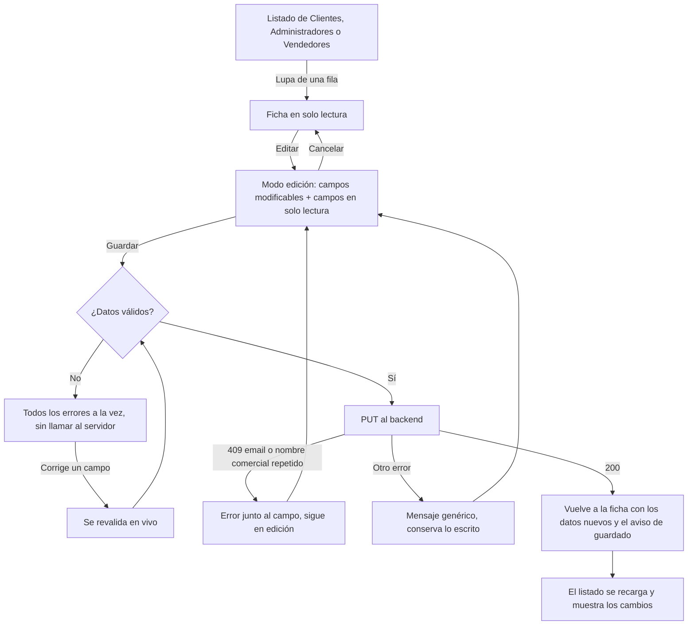

# HU22 · Modificar datos de un usuario (Frontend)

Documento para entender cómo el administrador edita los datos de clientes, administradores y vendedores desde su ficha: qué se puede cambiar en cada caso, qué hace cada parte del código, qué contrato espera del backend y cómo probarlo.

- **Fecha:** 9 de octubre de 2026
- **HU:** HU22 · Modificar datos y rol de un usuario (2 puntos)
- **Tasks:** AB#45 (formulario de edición) y AB#46 (tests del formulario de edición)
- **Rama:** `feature/US22-T45-T46-edicion-usuario`
- **Metodología:** sin TDD por decisión del equipo. Primero el código (commits `refactor`, `chore` y `feat` con AB#45) y después los tests (commit `test` con AB#46).
- **Depende de:** `docs/hu20-ficha-usuario.md` (ficha de clientes y administradores), `docs/hu26-supervision-vendedores.md` (ficha del vendedor), `docs/hu21-alta-admin-y-vendedores.md` (validaciones y piezas de cuenta), `docs/hu1-registro.md` (reglas del registro), `docs/mocks-msw.md` (mocks) y `docs/sonar-incidencias.md` (convención de `propTypes`)

---

## 1. Resumen

### Quién edita a quién

**Solo el administrador** edita datos de otros usuarios, y puede editar a **cualquier** cliente, administrador o vendedor, incluido él mismo. Ocurre desde la **ficha** de cada usuario (la que se abre con la lupa de los listados de Clientes, Administradores y Vendedores): la ficha tiene ahora el botón **Editar**.

> La barrera real es el backend (RBAC): `/api/admin/**` solo para el rol administrador. El frontend solo oculta o muestra los botones.

### Qué se puede cambiar

Al pulsar **Editar**, la ficha pasa a **modo edición**: los campos que se pueden modificar se vuelven campos normales y **el resto se queda en solo lectura, más oscuro**, para que se vea qué se puede tocar.

| Tipo | Se puede modificar | No se puede modificar |
|---|---|---|
| **Cliente** | Nombre, apellidos, DNI, teléfono, fecha de nacimiento (siempre que sea **mayor de edad**), tipo de cliente (Estándar o Premium) e imagen de perfil | **Email** y estado |
| **Administrador** | Nombre, apellidos, sede e imagen de perfil | **Email**, **fecha de incorporación**, estado y fecha de alta |
| **Vendedor** | **Todos sus datos**: nombre, apellidos, email, nombre comercial (que siga siendo **único**), NIF/DNI y categoría principal | Estado |

La **fecha de alta** solo se muestra en la ficha del **administrador**: la de clientes y vendedores no se guarda, así que su ficha no tiene ese campo.

Para los tres tipos:

- **La contraseña no se cambia desde aquí.** El campo no existe en el formulario. Solo se cambia con "He olvidado mi contraseña", igual para los tres tipos (esa pantalla todavía no existe en el frontend; ver la sección 9).
- **Los productos, los precios y los pedidos de un vendedor siguen siendo de solo lectura**, como en la HU26: mientras se edita, las pestañas Productos y Pedidos están deshabilitadas.
- **El estado** (activar o desactivar) sigue cambiándose con su propio botón y su confirmación (HU23 y HU24), no desde el formulario.

---

## 2. Flujo



---

## 3. Componentes y archivos

Todas las rutas son relativas a `frontend/src/`.

### Definición de los campos (`features/admin/`)

| Archivo | Qué hace |
|---|---|
| `profileFields.js` | **Una sola definición de los campos de cada tipo de usuario** que sirve para los dos modos. Cada campo indica su etiqueta, cómo se muestra en lectura (`read`) y, si se puede modificar, sus reglas (`edit`: tipo, obligatorio, longitud máxima y validación). Lo que no tiene `edit` es de solo lectura. Aquí están las reglas "qué se puede cambiar" de la sección 1. Exporta `readFields`, `initialValues`, `validateProfile` y `profilePayload`. |
| `ProfileEditor.jsx` | El formulario de edición. Pinta todos los campos de la ficha: los modificables como campos normales (texto, fecha, desplegable o selector de avatar) y el resto como solo lectura. Valida, muestra los errores, envía los cambios con la función `save` que recibe y avisa con `onSaved` o `onCancel`. No sabe nada del tipo de usuario: lo lee de `profileFields.js`. |
| `UserDetailDialog.jsx` | La ficha de clientes y administradores. Añade el botón **Editar**, el aviso "Modo edición" y el formulario. Ya no define sus propios campos: usa `readFields`. |
| `SellerDetailDialog.jsx` | La ficha del vendedor. Añade **Editar** (solo en la pestaña Datos), deshabilita las otras pestañas mientras se edita y carga las categorías para elegir la principal (`SellerEditor`). |
| `SellerDataForm.jsx` | Muestra los datos del vendedor en lectura con `readFields`. |

### Reglas compartidas, API y mocks

| Archivo | Qué hace |
|---|---|
| `features/account/accountRules.js` | Añade `esDniValido`, `esTelefonoValido` y `esMayorDeEdad`, que antes estaban dentro del registro. `pages/Register.jsx` las usa ahora desde aquí, sin cambiar su comportamiento. |
| `api/users.js` | `updateUser(userId, datos)`. |
| `api/adminSellers.js` | `updateAdminSeller(sellerId, datos)`. |
| `mocks/usersHandlers.js` | Simula `PUT /api/admin/usuarios/{id}`: valida, ignora el email, y recuerda los cambios durante la sesión. |
| `mocks/adminSellersHandlers.js` | Simula `PUT /api/admin/sellers/{id}`: valida y responde 409 si el nombre comercial o el email ya son de otra cuenta. |
| `mocks/fechas.js` | Comprobación de mayoría de edad de los mocks. |

---

## 4. Validación

| Campo | Regla |
|---|---|
| Nombre y apellidos | Obligatorios, máximo 30 caracteres |
| DNI (cliente) | Obligatorio, 8 números y una letra |
| Teléfono (cliente) | Opcional; si se rellena, 9 números |
| Fecha de nacimiento (cliente) | Obligatoria y de una persona **mayor de edad** (un día antes de cumplir los 18 ya no vale) |
| Tipo de cliente | Estándar o Premium |
| Sede (administrador) | Opcional, máximo 30 caracteres |
| Email (vendedor) | Obligatorio, formato válido, máximo 100 caracteres, único |
| Nombre comercial (vendedor) | Obligatorio, máximo 30 caracteres, único |
| NIF/DNI (vendedor) | Obligatorio, 9 caracteres alfanuméricos |
| Categoría principal (vendedor) | Obligatoria, una de las categorías del sistema |

- **Todos los errores a la vez** al pulsar **Guardar**, sin llamar al servidor si hay alguno.
- **En vivo después del primer intento:** el error de un campo desaparece en cuanto se corrige.
- **El servidor también valida.** Si el email o el nombre comercial ya son de otra cuenta, el mensaje sale junto a su campo ("Este email ya está registrado", "Este nombre comercial ya está registrado"). Cualquier otro fallo da el mensaje genérico "No se han podido guardar los cambios", sin detalles internos, y el formulario conserva lo escrito.
- **Doble clic:** mientras se guarda, los botones se deshabilitan y solo se envía una petición.

---

## 5. Seguridad

- **Solo administradores.** Las rutas están protegidas y los mocks responden 401 sin sesión y 403 con otro rol. La barrera real es el backend.
- **No viajan datos que no se pueden cambiar:** nunca se envían el email de clientes y administradores, la fecha de incorporación, el estado ni la contraseña (`profilePayload` solo incluye los campos modificables). Si el backend recibiera uno, debe ignorarlo o rechazarlo.
- **No existe campo de contraseña** en ninguna ficha, ni en lectura ni en edición.
- **Los errores del servidor no se muestran tal cual,** solo mensajes fijos.

---

## 6. Contrato esperado del backend

**El frontend se ha desarrollado y probado con mocks (MSW).** Las rutas y los formatos los ha definido el frontend; **hay que acordarlos con el backend.**

### Clientes y administradores

`PUT /api/admin/usuarios/{id}`. El cuerpo depende del rol del usuario:

```json
{ "nombre": "Carla", "apellidos": "Moreno Gil", "dni": "10004119A", "telefono": "620023757",
  "fechaNacimiento": "1978-04-13", "tipoCliente": "PREMIUM", "avatar": "avatar1" }
```

```json
{ "nombre": "Diego", "apellidos": "Delgado Iglesias", "sede": "Cuenca", "avatar": "avatar3" }
```

### Vendedores

`PUT /api/admin/sellers/{id}`

```json
{ "nombre": "Vera", "apellidos": "Vendedora", "email": "vendedor@esibuy.test",
  "nombreComercial": "TecnoVera", "nif": "B12345601", "categoriaPrincipalId": "cat-1" }
```

### Respuestas

| Respuesta | Significado para el frontend |
|---|---|
| 200 + datos del usuario | Guardado. La ficha se recarga |
| 400 (`VALIDATION_ERROR`) | Mensaje genérico |
| 409 + `{ "code": "EMAIL_ALREADY_REGISTERED" }` | "Este email ya está registrado" (solo vendedores) |
| 409 + `{ "code": "COMMERCIAL_NAME_ALREADY_REGISTERED" }` | "Este nombre comercial ya está registrado" |
| 401 / 403 / 404 / 5xx | Mensaje genérico |

### Qué debe imponer el backend

- Que solo el administrador pueda llamar a estos endpoints.
- Que el email de clientes y administradores y la fecha de incorporación **no cambien nunca**, aunque lleguen en el cuerpo.
- Que la contraseña no se pueda cambiar por esta vía.
- La mayoría de edad de la fecha de nacimiento y la unicidad del nombre comercial y del email.
- **El detalle del vendedor** (`GET /api/admin/sellers/{id}`) debe incluir `categoriaPrincipalId` además de `categoriaPrincipal` (el nombre), porque el formulario elige la categoría por identificador.

---

## 7. Datos de prueba y cómo verlo en el navegador

Con `npm run dev` (mocks activos): `admin@esibuy.test`, contraseña `Mock-Clave-1!`, código de correo `654321` y código de Authenticator `123456`. Los cambios se olvidan al recargar la página.

| Prueba | Resultado |
|---|---|
| **Clientes** → lupa de `Carlos Moreno Gil` → **Editar** | Nombre, apellidos, DNI, teléfono, fecha de nacimiento, tipo e imagen se pueden cambiar; email y estado, oscuros; no hay fecha de alta |
| Poner una fecha de nacimiento de hace 10 años → **Guardar** | "Debe ser mayor de edad" |
| Vaciar nombre y DNI → **Guardar** | Los dos errores a la vez |
| Cambiar el nombre → **Guardar** | Vuelve a la ficha con el aviso "Los cambios se han guardado." y el listado muestra el nombre nuevo |
| **Administradores** → lupa de `Diego Delgado Iglesias` → **Editar** | Solo se pueden cambiar nombre, apellidos, sede e imagen; email y fecha de incorporación, oscuros |
| **Administradores** → lupa de `Ada Admin` (la sesión) → **Editar** | Un administrador puede editar sus propios datos |
| **Vendedores** → lupa de `TecnoVera` → **Editar** | Todos los datos se pueden cambiar; las pestañas Productos y Pedidos están deshabilitadas |
| Cambiar el nombre comercial a `Casa Vicente` | "Este nombre comercial ya está registrado" |
| Cambiar el email a `hugo@esibuy.test` | "Este email ya está registrado" |
| Cambiar la categoría principal a **Hogar** → **Guardar** | La ficha muestra **Hogar** |
| **Cancelar** | Vuelve a la ficha sin guardar nada |

### Tests automáticos

```bash
npx vitest run     # 513 tests (108 son de esta HU)
npm run lint
npm run build
```

| Archivo | Tests nuevos | Qué cubre |
|---|---|---|
| `features/admin/profileFields.test.js` | 38 | Qué campos son modificables en cada tipo, que nunca se pueda cambiar la contraseña, valores iniciales, validación (valores límite de la mayoría de edad incluidos) y cuerpo de la petición |
| `features/admin/ProfileEditor.test.jsx` | 21 | Campos modificables y de solo lectura por tipo, obligatorios a la vez, validación en vivo, guardado, errores 409 junto al campo, error genérico, doble clic y cancelar |
| `features/admin/UserDetailDialog.test.jsx` | 16 | Botón Editar, modo edición de clientes y administradores, guardado y datos enviados, tipo de cliente, mayoría de edad, sede, edición de la propia cuenta y cancelar |
| `features/admin/SellerDetailDialog.test.jsx` | 17 (y 1 modificado) | Editar solo en la pestaña Datos, pestañas deshabilitadas, guardado, categoría, nombre comercial y email únicos, errores, categorías que no cargan y cancelar. El test que decía que la ficha no tenía botón de editar ya no aplica y se sustituyó |
| `features/account/accountRules.test.js` | 9 | DNI, teléfono y mayoría de edad |
| `api/users.test.js`, `api/adminSellers.test.js` | 3 y 2 | Las dos llamadas nuevas |
| `pages/AdminClientsPage.test.jsx`, `pages/AdminSellersPage.test.jsx` | 1 y 1 | Que el listado muestra el nombre nuevo tras editar desde la ficha |

Los 405 tests anteriores siguen pasando.

---

## 8. Decisiones y librerías

- **No se ha añadido ninguna librería nueva.**
- **Una sola definición de campos (`profileFields.js`)** para los dos modos y para los tres tipos de usuario: evita repetir etiquetas y reglas, y hace que "qué se puede editar" esté en un solo sitio. Cambiar una regla de edición es tocar una línea.
- **El formulario edita en la propia ficha** (no en una página aparte), igual que la ficha y su estado: el administrador no pierde el listado ni su posición.
- **Vendedor, "todo se puede modificar":** se ha entendido como todos los datos de su cuenta, incluido el email, y no el estado (que se cambia con su propio botón). Si el email del vendedor tampoco debe cambiar, basta con quitar la propiedad `edit` de ese campo en `profileFields.js`.
- **Fecha de alta solo en administradores:** la de clientes y vendedores no se guarda, así que se quitó de sus fichas. El listado general de usuarios (HU19) y el de clientes siguen teniendo la columna "Fecha de alta" de `UsersTable`; si tampoco debe mostrarse, hay que quitarla de la tabla y del contrato.
- **El rol no se cambia en esta pantalla.** El título de la HU habla de "datos y rol", pero lo pedido por el equipo no incluye cambiar el rol de un usuario. Por eso las reglas "no quitarse el propio rol" y "no degradar al último administrador" no aplican hoy en el frontend (no hay forma de hacerlo). Si se añade cambiar el rol, esas dos reglas las impondría el backend y el frontend mostraría el motivo, como en la HU23.
- **Cliente Premium:** el administrador puede pasar a un cliente de Estándar a Premium y al revés. Pasar a Premium en el registro lleva a un flujo de pago que aún no existe; no hay que confundirlos.
- **Los mensajes del servidor** son fijos y genéricos, como en el resto de pantallas.

## 9. Limitaciones y trabajo pendiente

- **"He olvidado mi contraseña"** es la única vía de cambio de contraseña para los tres tipos de usuario, pero **esa pantalla todavía no existe** (el login no tiene el enlace). Hasta entonces, nadie puede cambiar su contraseña.
- **Cambiar el rol** de un usuario no está en esta HU (ver la sección 8).
- **Cambiar el email de un vendedor** puede afectar a su inicio de sesión; conviene confirmar con el backend si ese cambio exige verificar el nuevo correo.
- **Imagen de perfil del vendedor:** la ficha del vendedor no tiene imagen de perfil, así que no se edita.
- **Matriz de trazabilidad:** esta HU no tiene casos de prueba (`HU22-CPnn`) definidos en Azure Boards, así que los tests nuevos no están en `docs/calidad/matriz-trazabilidad.md`. Hay que añadirlos cuando el equipo defina los casos.
- Aspecto visual sin revisar en un navegador real (ver la sección 10).

---

## 10. Uso de IA generativa

Este documento y el trabajo técnico que describe se hicieron con ayuda de un asistente de IA generativa, como exige el enunciado.

- **Herramienta:** Claude (modelo de Anthropic), mediante Claude Code.
- **Qué generó la IA:** la definición de campos, el formulario de edición, los cambios en las dos fichas, los mocks, los tests y este documento. Las decisiones de producto las tomó el equipo: quién puede editar a quién, qué campos se pueden modificar en cada tipo de usuario (incluida la regla de mayoría de edad y la unicidad del nombre comercial), que la contraseña solo se cambie con "He olvidado mi contraseña" y que los productos, precios y pedidos del vendedor sigan siendo de solo lectura.
- **Cómo se comprobó:** se ejecutaron los **513 tests (todos en verde)**, ESLint sin errores y un build de producción correcto.
- **Qué NO se comprobó:** la pantalla en un navegador real ni su aspecto visual (por ejemplo, el contraste entre campos modificables y de solo lectura), ni el flujo contra un backend real. El contrato de la sección 6 debe acordarse con el backend.
- **Cómo guió el proceso:** el asistente siguió el flujo de ramas y commits del proyecto (refactor, mocks, código, tests y documentación en commits separados, con los AB# de las tasks).
- **Revisión humana:** el código fue revisado, ejecutado y validado por el equipo antes de su integración. Revisado por: Ricardo.
