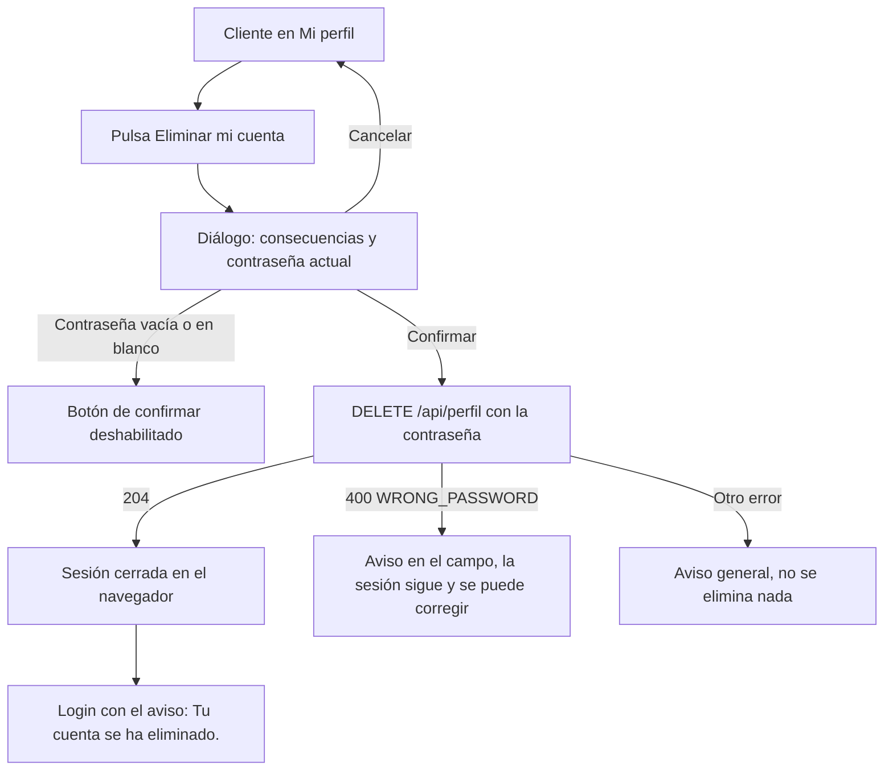

# HU25 · Eliminar mi cuenta de cliente (Frontend)

Documento para entender cómo el cliente elimina su propia cuenta desde su perfil: dónde está la opción, qué le explica el diálogo de confirmación, qué pasa al confirmar, qué contrato espera del backend y cómo reutiliza lo que ya hizo la HU47 para el vendedor.

- **Fecha:** 9 de noviembre de 2026
- **HU:** HU25 · Eliminar mi cuenta de cliente (AB#86)
- **Tasks:** T272 (AB#272, botón de eliminación de cuenta) y T273 (AB#273, confirmación y comunicación de consecuencias)
- **Rama:** `feature/US25-T272-T273-eliminar-cuenta-cliente-front`
- **Metodología:** TDD. Cada pieza tiene su commit de rojo (`test(front-HU25)`) antes del de verde (`feat(front-HU25)`).
- **Depende de:** el backend de la HU25 (T274 y T275, PR #235, ya en `develop`: un único `DELETE /api/perfil` para cliente y vendedor, con el borrado en cascada de los datos del cliente) y de la HU47 (`DeleteAccountDialog` y la sección del perfil, PR #223); `docs/hu4-vista-perfil.md` (perfil) y `docs/hu43-cerrar-sesion.md` (cierre de sesión).

---

## 1. Resumen

En **Mi perfil**, el cliente tiene la sección **Eliminar mi cuenta**, la misma que ya tenía el vendedor desde la HU47. Su botón abre un diálogo que explica qué se elimina y qué se conserva y pide la contraseña actual. Al confirmar, el servidor borra la cuenta y cierra la sesión; el navegador la cierra también, lleva al login y avisa «Tu cuenta se ha eliminado.». Con esa cuenta ya no se puede iniciar sesión.

| Criterio de aceptación | Cómo se cumple |
|---|---|
| La opción está en el perfil del propio usuario, no en el panel de administración | Sección `AccountDeletion` de `ProfilePage`, para cliente y vendedor. El administrador no tiene perfil: `/profile` lo devuelve a su panel y la opción no aparece en ningún sitio de su zona. |
| Para confirmar se pide la contraseña actual | `DeleteAccountDialog` pide la contraseña actual con `PasswordField`; el botón de confirmar no se activa sin ella. |
| Tras eliminar la cuenta se cierra la sesión y ya no se puede iniciar sesión con ella | `accountDeleted()` de `AuthContext` cierra la sesión del navegador y el login avisa. El backend borra al usuario, así que el login falla; en los mocks, la cuenta borrada deja de existir para el login. |

---

## 2. Flujo

---

## 3. Qué se elimina y qué se conserva

Son las consecuencias del backend (PR #235, decisión del profesor del 06/11/2026) y salen de una sola configuración por rol dentro de `DeleteAccountDialog`; el diálogo recibe el rol y no hay dos copias del texto.

| Rol | Se elimina | Se conserva |
|---|---|---|
| Cliente | Sus direcciones, métodos de pago, carrito, lista de deseos y preferencias, y la configuración del doble factor. El borrado es físico. | Los pedidos y las valoraciones, para las estadísticas y los históricos. |
| Vendedor (HU47, sin cambios) | Los productos que no tienen pedidos. | Los productos con pedidos, desactivados; los pedidos y las valoraciones. |

En los dos casos se cierra la sesión y no se puede volver a entrar con la cuenta.

---

## 4. Archivos

| Archivo | Cambio |
|---|---|
| `src/pages/ProfilePage.jsx` | `AccountDeletion` sale para el cliente y el vendedor, y pasa su rol al diálogo. |
| `src/features/account/DeleteAccountDialog.jsx` | Recibe `rol` y muestra sus consecuencias; el foco va al campo de contraseña al abrirse; el error de contraseña sale en el propio campo; la contraseña actual no se puede copiar ni cortar (R9). |
| `src/mocks/profileHandlers.js` | `DELETE /api/perfil` también para el cliente. |
| `src/mocks/authHandlers.js` | `eliminarCuentaMock`: la cuenta eliminada deja de existir para el login hasta que se reinician los mocks. |

---

## 5. Contrato usado

Un único `DELETE /api/perfil` con `{ "password": "..." }`, para el cliente y para el vendedor (backend: PR #235, T274 y T275).

| Respuesta | Cuándo | Qué hace el frontend |
|---|---|---|
| 204, sesión y cookie cerradas | Contraseña correcta | Cierra la sesión del navegador y va al login con el aviso. |
| 400 `WRONG_PASSWORD` | Contraseña incorrecta (la sesión sigue abierta, no es un 401) | Avisa en el campo y deja corregirla. |
| 400 de validación | Falta la contraseña | El botón no se activa en blanco, así que no se envía; si llegara, aviso general. |
| 401 | Sin sesión | El cliente HTTP ya trata el 401 como sesión caducada (HU43). |
| 403 `ACCESS_DENIED` | Administrador | No ve la opción. |

El PR #235 ya está en `develop`: antes, el controlador llamaba solo a la eliminación del vendedor y un cliente recibía 403. Los mocks cumplen este contrato, y conviven con el backend real.

---

## 6. Decisiones

- **Se reutiliza la HU47.** La sección del perfil y el diálogo son los mismos; el diálogo recibe `rol` (`CLIENTE` o `VENDEDOR`) y un mapa interno da las consecuencias de cada uno. El vendedor no cambia, salvo los tres ajustes siguientes, que valen para los dos roles.
- **El error de contraseña sale en el propio campo** (`PasswordField` con `error`) y desaparece al corregirla; los demás fallos van en un aviso general (`MessageBar`).
- **La contraseña actual no se puede copiar ni cortar** (`bloquearCopia`, R9): es una contraseña que ya existe. Pegar sigue permitido, para los gestores de contraseñas. `PasswordField` no se toca.
- **Un único botón «Eliminar mi cuenta» sin confirmación extra:** el diálogo ya es la confirmación y pide la contraseña.
- **El botón no se activa con solo espacios**, igual que el backend rechaza una contraseña en blanco.
- **Foco al campo de contraseña al abrir.** El diálogo de Fluent enfoca su superficie; el campo se enfoca a mano al abrirse. No se añade nada a `PasswordField`.
- **Mocks:** la cuenta del cliente eliminada deja de existir para el login; la del vendedor no se borra, como antes. Sin contraseña, el mock responde 400 `VALIDATION_ERROR` (antes, `WRONG_PASSWORD`), como el backend.

---

## 7. Tests

Los casos siguen la numeración del backend (HU25-CP01 a CP06): el frontend empieza en el CP07. Todos están pendientes de confirmar con el equipo.

| Caso | Task | Qué se prueba | Archivo |
|---|---|---|---|
| HU25-CP07 | AB#272 | El cliente tiene la sección en su perfil y el administrador no; el botón abre la confirmación y cancelar no elimina nada | `ProfilePage.test.jsx` |
| HU25-CP08 | AB#273 | Las consecuencias del cliente, que no ve las del vendedor, y las del vendedor no cambian | `DeleteAccountDialog.test.jsx` |
| HU25-CP09 | AB#273 | Contraseña vacía o con solo espacios: no se confirma; el foco está en el campo | `DeleteAccountDialog.test.jsx` |
| HU25-CP10 | AB#273 | `WRONG_PASSWORD` en el campo y corregible; fallo genérico (500, validación o red); botones deshabilitados al enviar; se envía solo la contraseña | `DeleteAccountDialog.test.jsx` |
| HU25-CP11 | AB#273 | La contraseña actual no se copia ni se corta (R9), pero se pega, en los dos roles | `DeleteAccountDialog.test.jsx` |
| HU25-CP12 | AB#273 | Con la contraseña correcta se cierra la sesión, se va al login con el aviso y la zona deja de ser accesible; con una incorrecta la sesión sigue | `ProfilePage.test.jsx` |
| HU25-CP13 | AB#273 | Tras eliminar la cuenta no se puede iniciar sesión con ella y las demás cuentas siguen entrando | `ProfilePage.test.jsx` |

Cambia también el test HU47-CP13 de `ProfilePage.test.jsx`, que ya no dice que el cliente no tiene la opción. Los tests HU47-CP09 a CP12 del diálogo pasan sin cambios.

---

## 8. Pendiente

- **Matriz:** rellenar el número de este PR (`PR pendiente`) y pasar los tests de 🔍 a ✅ al mergear.
- **Casos de prueba:** HU25-CP07 a CP13 están propuestos y pendientes de confirmar con el equipo.
