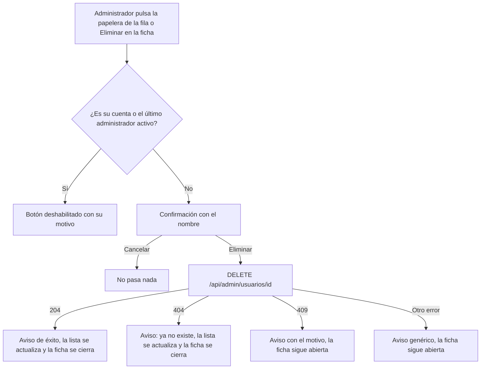

# HU37 · Eliminar administrador (Frontend)

Documento para entender cómo el administrador elimina la cuenta de otro administrador: dónde está la acción, qué reglas la protegen, qué contrato espera del backend y cómo probarla.

- **Fecha:** 4 de noviembre de 2026
- **HU:** HU37 · Eliminar administrador
- **Task:** T338 (AB#338), parte de frontend. El backend (`DELETE /api/admin/usuarios/{id}`, AB#340) ya está en `develop`.
- **Rama:** `feature/US37-T338-boton-eliminacion-administrador`
- **Metodología:** TDD, con un commit de rojo (`test(front-HU37)`) antes del de verde (`feat(front-HU37)`) en cada ciclo.
- **Depende de:** `docs/hu19-listado-usuarios.md` (la papelera de la fila, `UserRowActions`), `docs/hu20-ficha-usuario.md` (la ficha) y `docs/hu43-cerrar-sesion.md` (el 401 con sesión abierta).

---

## 1. Resumen

El administrador puede eliminar la cuenta de otro administrador **desde la fila del listado** (papelera) y **desde su ficha** (botón *Eliminar* con texto). Las dos usan el mismo componente, `UserDeleteButton`, con la misma confirmación, las mismas reglas y los mismos avisos.

| Criterio de aceptación | Cómo se cumple |
|---|---|
| La acción está en la ficha (HU20) y en la fila del listado (HU19) | Papelera en `UserRowActions` y botón *Eliminar* en `UserDetailDialog`, ambos con `UserDeleteButton`. |
| Se pide confirmación indicando el nombre del usuario | `StatusConfirmDialog`: «¿Seguro que quieres eliminar a *nombre*? Esta acción no se puede deshacer.» |
| Un administrador no puede eliminarse a sí mismo desde el panel | El botón queda deshabilitado para `currentUserId`, con el texto emergente «No puedes eliminar tu propia cuenta.». Si aun así llegara un 409 `CANNOT_DELETE_SELF`, se muestra el mismo motivo. |
| No se puede eliminar al último administrador del sistema | Deshabilitado para `lastAdminId` (`useLastActiveAdmin`) con «No se puede eliminar al último administrador activo.». También se muestra si llega un 409 `LAST_ACTIVE_ADMIN`. |
| La sesión del administrador eliminado deja de ser válida | La invalida el backend (`CuentaActivaFilter`). Su siguiente petición recibe un 401 y el frontend ya lo trata (HU43): cierra la sesión y lleva al login con «Tu sesión ha caducado. Vuelve a iniciar sesión.». Ver sección 6. |
| El borrado es físico | Lo hace el backend; el frontend solo envía el `DELETE`. |

### Solo se eliminan administradores

El backend responde **404 a quien no es administrador** (hoy no hay HU para eliminar clientes ni vendedores). Para no ofrecer un botón que siempre falla, la papelera y el botón de la ficha **solo salen para administradores**: `UserRowActions` y `UserDetailDialog` los muestran únicamente con la propiedad `canDelete`.

| Listado | ¿Papelera? |
|---|---|
| Administradores (`AdminAdminsPage`, vía `RoleUsersList`) | Sí, en todas las filas |
| Usuarios (`AdminUsersPage`) | Solo en las filas con rol Administrador |
| Clientes (`AdminClientsPage`) | No |
| Vendedores (`AdminSellersPage`) | No |

Cuando exista la HU de eliminar clientes o vendedores, bastará con pasar `canDelete` en sus listados.

---

## 2. Flujo



Los avisos salen en la barra de la página del listado (`onResult` con `intent` `success` o `error`), como los de bloquear y desbloquear, aunque la ficha ya se haya cerrado.

---

## 3. Componentes y archivos

Todas las rutas son relativas a `frontend/src/`.

| Archivo | Qué hace |
|---|---|
| `features/admin/UserDeleteButton.jsx` | **Nuevo.** El botón (icono, o icono y texto con `withText`), sus reglas de deshabilitado, la confirmación, la llamada a `deleteUser` y los avisos. Recibe `user`, `label`, `currentUserId`, `lastAdminId`, `onResult`, `onChanged` y `onDeleted`. Lo extraje de `UserRowActions` para no duplicar la lógica entre la fila y la ficha. |
| `features/admin/UserRowActions.jsx` | Usa `UserDeleteButton` cuando recibe `canDelete` y le pasa `canDelete` a la ficha que abre la lupa. Ya no contiene la lógica de eliminar. |
| `features/admin/UserDetailDialog.jsx` | Con `canDelete` añade, cuando la ficha ha cargado, un pie con el botón *Eliminar*. Al eliminar (o si el administrador ya no existía) se cierra. |
| `features/admin/RoleUsersList.jsx`, `pages/AdminUsersPage.jsx` | Pasan `canDelete` solo para administradores. |
| `api/users.js` | `deleteUser(userId)`: su comentario describe ya el contrato real del backend. |
| `mocks/usersHandlers.js` | El `DELETE` del mock responde como el backend (ver sección 4). |
| `mocks/adminSellersHandlers.js` | Se quitó el borrado de vendedores del mock (`eliminados` y `eliminarVendedorMock`), que ya no se usa. |

`SellerDetailDialog` no cambia: los vendedores no se eliminan.

---

## 4. Contrato del backend

| Endpoint | Respuesta |
|---|---|
| `DELETE /api/admin/usuarios/{id}` | 204 sin cuerpo |

| Estado | Cuándo | Qué hace el frontend |
|---|---|---|
| 404 | La cuenta no existe **o no es de un administrador** | «*nombre* ya no existe. Se ha actualizado la lista.» (error), actualiza la lista y cierra la ficha |
| 409 `CANNOT_DELETE_SELF` | Es la propia cuenta | «No puedes eliminar tu propia cuenta.» |
| 409 `LAST_ACTIVE_ADMIN` | Es el último administrador activo | «No se puede eliminar al último administrador activo.» |
| 401 | Sin sesión, o sesión invalidada | Cierra la sesión y lleva al login (HU43) |
| 403 `ACCESS_DENIED` | Otro rol | Aviso genérico «No se ha podido eliminar a *nombre*. Inténtalo de nuevo.» |
| Otro | | El mismo aviso genérico |

El mock sigue ahora este contrato: 204 solo para administradores que no sean la propia cuenta ni el último activo, 404 para clientes, vendedores y cuentas que no existen, 409 con el código y 401 y 403 según la sesión.

---

## 5. Datos de prueba y cómo verlo en el navegador

Con `npm run dev` (mocks activos): `admin@esibuy.test`, contraseña `Mock-Clave-1!`, código de correo `654321` y código de Authenticator `123456`. Ese usuario es `Ada Admin`.

1. **Panel de control → Administradores**: cada fila tiene la papelera. La de `Ada Admin` está deshabilitada y su texto emergente explica por qué.
2. Pulsar la papelera de `Diego Delgado Iglesias` (administrador bloqueado): aparece la confirmación con su nombre. **Cancelar** no hace nada. **Eliminar** muestra «Diego Delgado Iglesias se ha eliminado.» y la fila desaparece.
3. Pulsar la lupa de otro administrador: la ficha tiene el botón *Eliminar*. Eliminar desde ahí cierra la ficha, avisa y actualiza la lista.
4. **Panel de control → Usuarios**: la papelera solo está en las filas de administradores; los clientes no la tienen. En **Clientes** y **Vendedores** no hay papelera.
5. Para ver el último administrador activo, eliminar o bloquear a los demás administradores activos hasta que quede uno: su papelera se deshabilita con «No se puede eliminar al último administrador activo.».

### Tests automáticos

```bash
npx vitest run
npm run lint
npm run build
```

| Archivo | Qué cubre |
|---|---|
| `features/admin/UserDeleteButton.test.jsx` | Confirmación con el nombre, eliminar, cancelar, nombre alternativo (`label`), botón con y sin texto, deshabilitado para la propia cuenta y el último administrador, 409 de los dos códigos, 404 y error genérico (CP12 a CP17) |
| `features/admin/UserDetailDialog.test.jsx` | El botón de la ficha: aparece solo con `canDelete`, confirmar, cancelar, deshabilitado, 409 y 404 (CP13 a CP18) |
| `features/admin/UserRowActions.test.jsx` | Sin `canDelete` no hay papelera (clientes y vendedores), la ficha abierta desde la fila ofrece Eliminar y lo cierra al eliminar (CP14, CP18) |
| `features/admin/RoleUsersList.test.jsx` | Eliminar desde la fila del listado de administradores y la papelera deshabilitada de la propia cuenta (CP12, CP15) |
| `pages/AdminUsersPage.test.jsx`, `pages/AdminSellersPage.test.jsx` | Papelera solo en filas de administradores, y ninguna en vendedores (CP12, CP18) |
| `api/users.test.js` | El mock responde como el backend: 204, 404, 409, 401 y 403 (CP20) |
| `features/auth/LoginFlow.test.jsx` | Un 401 con la sesión abierta lleva al login con el aviso (CP19) |

Los casos están trazados en `docs/calidad/matriz-trazabilidad.md` (HU37-CP12 a CP20; CP01 a CP11 son del backend). Los tests anteriores de eliminar de la HU19 se mantienen con sus nombres, pero los que usaban clientes y vendedores ahora usan administradores.

---

## 6. Sesión del administrador eliminado

No ha hecho falta cambiar código. `api/client.js` avisa de cualquier 401 y `AuthProvider` cierra la sesión del navegador (`SESSION_END.EXPIRED`) si había una abierta; las rutas protegidas llevan al login, que muestra «Tu sesión ha caducado. Vuelve a iniciar sesión.». Es el mecanismo de la HU43 y el eliminado lo recibe en su **siguiente petición**, no al instante.

Limitación: el aviso habla de caducidad y no dice que la cuenta se ha dado de baja. Cambiarlo es código de la HU43, así que no se ha tocado.

---

## 7. Decisiones

- **Un componente común (`UserDeleteButton`)** para la fila y la ficha, en lugar de duplicar o de pasar funciones: la regla de «propia cuenta» y «último administrador» vive en un solo sitio.
- **Papelera solo para administradores (`canDelete`):** el backend responde 404 al resto; un botón que siempre falla confunde. La alternativa de dejarla con un mensaje de error se descartó.
- **El 404 se trata como «ya no existe»**, actualiza la lista y cierra la ficha, porque lo habitual es que otra persona la haya borrado antes. Si el 404 viniera de intentar eliminar a un no administrador, el botón ni siquiera se ofrece.
- **Sin cambio en el 401:** ya funciona (sección 6).
- **Mock fiel al backend:** devuelve 404 para quien no es administrador.

## 8. Limitaciones y trabajo pendiente

- Eliminar clientes y vendedores (otras HU): el backend los trata como inexistentes.
- El 409 `LAST_ACTIVE_ADMIN` del backend dice «No se puede **bloquear** al último administrador activo» también al eliminar. El frontend usa su propio texto, así que no se ve.
- El aviso de sesión caducada no distingue la baja de la cuenta.
- Aspecto visual sin revisar por una persona en un navegador real.

---

## 9. Uso de IA generativa

Este documento y el trabajo técnico que describe se hicieron con ayuda de un asistente de IA generativa, como exige el enunciado.

- **Herramienta:** Claude (modelo de Anthropic), mediante Claude Code.
- **Qué generó la IA:** el plan, la extracción de `UserDeleteButton`, el botón de la ficha, el ajuste de los listados y del mock, los tests (primero en rojo), la documentación y la matriz. El equipo decidió, al aprobar el plan: ocultar la papelera fuera de los administradores, el mensaje del 404, crear el componente nuevo con su archivo de tests, dónde probar la sesión invalidada y que el aviso salga en la página del listado.
- **Cómo se comprobó:** tests de Vitest, ESLint, build y cobertura desde `frontend/` (resultado en la descripción del PR). Dos tests nuevos pasaron ya en el ciclo rojo porque el código existente los cumplía: la ficha de un cliente sin Eliminar (CP18) y el 401 con sesión abierta (CP19).
- **Qué NO se comprobó:** la pantalla en un navegador real ni el flujo contra el backend real (solo mocks de MSW).
- **Revisión humana:** el código debe ser revisado, ejecutado y validado por el equipo antes de su integración.
