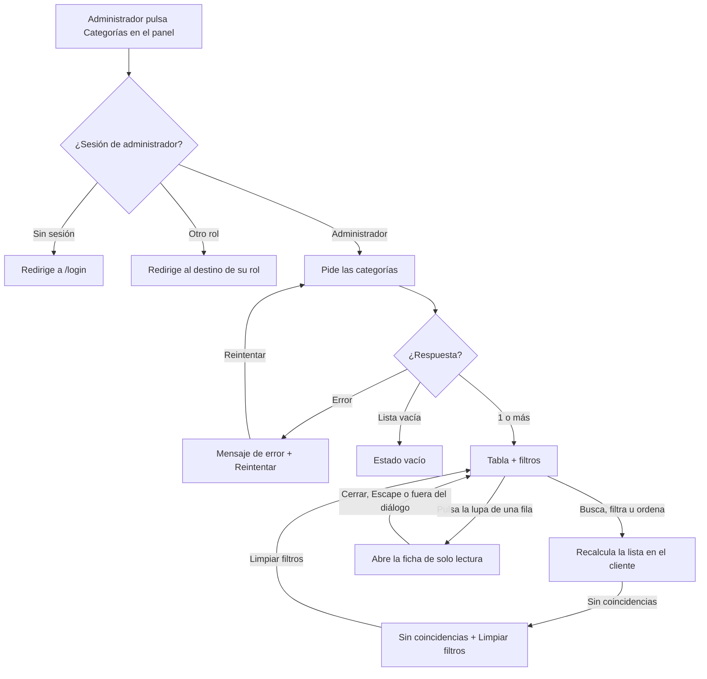
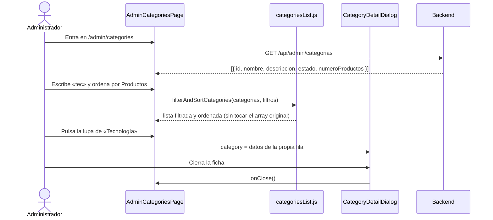

# HU39 · Consultar categorías (Frontend)

Documento para entender cómo el administrador consulta las categorías de productos: qué muestra la vista, cómo fluye la información, qué hace cada componente, qué contrato espera del backend y cómo probarla.

- **Fecha:** 4 de noviembre de 2026
- **HU:** HU39 · Consultar categorías
- **Task:** T330 (AB#330), parte de frontend. El backend (`GET /api/admin/categorias`) está hecho en otras tasks de la HU.
- **Rama:** `feature/US39-T330-vista-consulta-categorias`
- **Metodología:** TDD. Cada pieza tiene su commit de rojo (`test(front-HU39)`) antes del de verde (`feat(front-HU39)`).
- **Depende de:** `docs/hu2-login.md` (sesión y rutas protegidas), `docs/hu18-panel-admin.md` (panel), `docs/hu19-listado-usuarios.md` (filtros, ordenación y estados vacíos que se reutilizan) y `docs/hu26-supervision-vendedores.md` (ficha de solo lectura)

---

## 1. Resumen

Desde el panel de control, la tarjeta **Categorías** lleva a `/admin/categories`: una tabla con **todas** las categorías del sistema, también las inactivas, con su nombre, su descripción, su estado (Activa o Inactiva) y cuántos productos tiene cada una. Cada fila tiene una **lupa** que abre, por encima del listado, una ficha **de solo lectura** con la descripción completa.

La vista **no tiene botones de crear, editar ni eliminar**: eso llega con las historias HU40, HU41 y HU42.

| Criterio de aceptación | Cómo se cumple |
|---|---|
| El panel del administrador tiene la opción de categorías | Tarjeta **Categorías** en `AdminPage`, que navega a `/admin/categories`. |
| El listado muestra nombre, descripción, estado y número de productos | `CategoriesTable`, con las columnas Nombre, Descripción, Estado y Productos. Una descripción vacía se ve como «—». |
| El botón de consultar está en la tabla | Lupa en cada fila («Ver información de *nombre*») que abre `CategoryDetailDialog`. |
| Cualquier llamada sin rol de administrador devuelve 403 | El backend responde 401 sin sesión y 403 `ACCESS_DENIED` con otro rol. La ruta ya redirige a quien no es administrador y, si aun así llega un 403, la vista muestra un error genérico con **Reintentar**. |
| El nombre es obligatorio y único | No aplica a esta vista: solo muestra el nombre. Lo valida el backend al crear o editar (HU40 y HU41). |

### Filtros y ordenación del listado

El endpoint devuelve el array completo, sin paginar y ordenado por nombre. Por eso la búsqueda, el filtro y la ordenación se hacen **en el cliente**, y no hay paginación.

| Control | Opciones | Por defecto |
|---|---|---|
| Buscar por nombre | Texto libre; no distingue mayúsculas ni tildes y busca en cualquier parte del nombre (no en la descripción) | Vacío |
| Estado | Todos, Activa, Inactiva | Todos |
| Ordenar por | Nombre, Productos, Estado | Nombre |
| Dirección | Ascendente o Descendente (botón que se invierte al pulsarlo) | Ascendente |

- Por **estado** ascendente van primero las activas; a igualdad, desempata el nombre. Por **productos** ascendente va primero la que menos tiene; a igualdad, el nombre.
- **Limpiar filtros** vacía la búsqueda y el estado, pero mantiene la ordenación elegida.
- Los controles solo aparecen cuando hay alguna categoría. Si no hay ninguna, se muestra un estado vacío.

---

## 2. Flujo

### Flujo de la pantalla



### Flujo de datos



La ficha **no hace ninguna petición**: no existe un endpoint de detalle de categoría y la fila ya trae todos los datos, incluida la descripción completa.

---

## 3. Componentes y archivos

Todas las rutas son relativas a `frontend/src/`.

### Páginas y rutas

| Archivo | Qué hace |
|---|---|
| `pages/AdminCategoriesPage.jsx` | Pantalla del listado. Pide las categorías con `useApiQuery`, guarda búsqueda, estado, orden y categoría seleccionada, y orquesta filtros, tabla y ficha. Gestiona los estados: cargando, error con **Reintentar**, sin categorías y sin coincidencias. Incluye el enlace **Volver al panel**. |
| `pages/AdminPage.jsx` | Nueva tarjeta **Categorías** (icono `TagMultiple24Regular`) que navega a `/admin/categories`. |
| `routes/paths.js` / `routes/AppRoutes.jsx` | Nueva ruta `ADMIN_CATEGORIES` (`/admin/categories`), dentro del `ProtectedRoute` del administrador. |

### Funcionalidad del administrador (`features/admin/`)

| Archivo | Qué hace |
|---|---|
| `CategoriesTable.jsx` | Tabla de categorías: Nombre, Descripción, Estado y Productos. La descripción se recorta con puntos suspensivos y lleva `title` con el texto completo; si está vacía muestra «—». Acepta `renderActions` para añadir la columna **Acciones** (la página le pasa la lupa) y `refreshing` para atenuarla. |
| `CategoryDetailDialog.jsx` | Diálogo modal «Información de la categoría», con el aviso «Modo solo lectura», los campos Nombre, Estado y Productos (`ReadOnlyFields`) y la descripción completa en un `Textarea` de solo lectura. Solo tiene el botón **Cerrar**. |
| `categoryStatus.js` | Traduce el estado de la categoría a texto y color de `Badge`: Activa (éxito), Inactiva (neutro) y Desconocido (neutro) para cualquier otro valor. También ofrece las etiquetas del filtro de estado. |
| `categoriesList.js` | Lógica pura de la vista: `filterAndSortCategories` (búsqueda sin mayúsculas ni tildes, filtro por estado y ordenación estable por nombre, productos o estado; no modifica el array que recibe) y `CATEGORY_SORT_OPTIONS`. |

### Componentes y utilidades compartidas que se reutilizan

`UsersFilters` (búsqueda y desplegable de estado), `SortControls` (ordenación), `ReadOnlyFields` (campos de solo lectura), `EmptyState`, `LinkButton`, `usePageStyles`, `useTableStyles` y `useApiQuery`. No se ha modificado ninguno.

### API y mocks

| Archivo | Qué hace |
|---|---|
| `api/adminCategories.js` | `getAdminCategories()`: `GET /api/admin/categorias`. |
| `mocks/adminCategoriesHandlers.js` | Simula el endpoint: 401 sin sesión, 403 `ACCESS_DENIED` con otro rol y, para el administrador, 8 categorías de ejemplo ordenadas por nombre. Registrado en `mocks/handlers.js`. |

---

## 4. Contrato esperado del backend

| Endpoint | Parámetros | Respuesta 200 |
|---|---|---|
| `GET /api/admin/categorias` | Ninguno | Array de categorías, **sin paginar**, ordenado por nombre e incluyendo las inactivas |

```json
[
  { "id": "cat-1", "nombre": "Tecnología", "descripcion": "Ordenadores, móviles y accesorios.",
    "estado": "ACTIVA", "numeroProductos": 18 }
]
```

| Valor | Posibles |
|---|---|
| `estado` | `ACTIVA`, `INACTIVA` (cualquier otro se muestra como «Desconocido») |
| `descripcion` | Texto, o `""` si la categoría no tiene |

| Estado HTTP | Significado para el frontend |
|---|---|
| 401, 403 `ACCESS_DENIED`, 5xx | Mensaje genérico «No se han podido cargar las categorías. Inténtalo de nuevo.» con **Reintentar**; nunca se muestra el texto ni el código del servidor |

No forman parte de esta tarea los endpoints de escritura (`POST`, `PUT` y `DELETE`).

---

## 5. Datos de prueba y cómo verlo en el navegador

Con `npm run dev` (mocks activos): `admin@esibuy.test`, contraseña `Mock-Clave-1!`, código de correo `654321` y código de Authenticator `123456`. Después, **Panel de control → Categorías**.

| Categoría del mock | Qué sirve para probar |
|---|---|
| `Hogar` (14 productos) | Descripción larga: se recorta en la tabla y se ve entera en la ficha |
| `Juguetes` (3 productos) y `Moda` (0) | Estado Inactiva |
| `Libros` y `Moda` | Sin descripción: se muestra «—» |
| `Mascotas` y `Moda` | Sin productos: se muestra 0 |
| `Tecnología` (18 productos) | La que más tiene, para ordenar por productos |

Hay 8 categorías: 6 activas y 2 inactivas.

Pruebas manuales sugeridas:

1. Comprobar que salen las 8, ordenadas por nombre, también las inactivas.
2. Buscar `tecnologia` (sin tilde y en minúsculas): sale `Tecnología`.
3. Filtrar por **Estado → Inactiva**: salen `Juguetes` y `Moda`.
4. Ordenar por **Productos** e invertir la dirección con el botón.
5. Buscar `zzzz`: aparece «sin coincidencias» y **Limpiar filtros** devuelve todas manteniendo el orden.
6. Pulsar la lupa de `Hogar`: la ficha muestra la descripción completa y solo se puede cerrar (con la X, con **Cerrar**, con Escape o pulsando fuera).
7. Comprobar que no hay botones de crear, editar ni eliminar.
8. **Volver al panel** regresa a `/admin`.
9. Con `vendedor@esibuy.test`, abrir `/admin/categories` a mano: redirige a `/seller/products`. Con `cliente@esibuy.test`, a `/products`. Sin sesión, a `/login`.

### Tests automáticos

```bash
npx vitest run
npm run lint
npm run build
```

| Archivo | Tests | Qué cubre |
|---|---|---|
| `api/adminCategories.test.js` | 2 | La llamada (`GET`, array) y un 403 como `ApiError` con estado y código (CP06) |
| `features/admin/categoryStatus.test.js` | 4 | Activa, Inactiva, Desconocido y etiquetas del filtro (CP07) |
| `features/admin/categoriesList.test.js` | 10 | Búsqueda, estado, combinación, ordenación por los tres criterios, desempates, sin mutar la entrada (CP08) |
| `features/admin/CategoriesTable.test.jsx` | 6 | Columnas, filas, descripción vacía, insignia de estado, columna de acciones y tabla ocupada al refrescar (CP07, CP09, CP10) |
| `features/admin/CategoryDetailDialog.test.jsx` | 6 | Datos y descripción completa, categoría inactiva sin descripción ni productos, solo lectura y aviso, cierre con la X y con Escape, y ausencia de botones de edición (CP11) |
| `pages/AdminCategoriesPage.test.jsx` | 19 | Carga, listado, vacío, ficha, errores 403 y 500 con Reintentar, búsqueda, estado, orden, Limpiar filtros, Volver al panel y acceso por rol (CP09 a CP16) |
| `pages/AdminPage.test.jsx` | 2 nuevos | La tarjeta Categorías y que navega a `/admin/categories` (CP15) |

Los casos están trazados en `docs/calidad/matriz-trazabilidad.md` (HU39-CP06 a CP16).

---

## 6. Decisiones

- **Filtrar y ordenar en el cliente:** el endpoint devuelve todas las categorías sin paginar, así que no hace falta pedir nada más al cambiar un filtro. Ninguna otra vista pagina en el cliente, por eso esta tampoco.
- **La lupa abre un diálogo con los datos de la fila:** no hay endpoint de detalle y la fila ya lleva la descripción completa, así que la ficha no hace peticiones. Es la misma forma de consultar que en los listados de usuarios (HU19 y HU26).
- **Sin acciones de escritura:** la columna de acciones solo tiene la lupa. Las acciones de editar y eliminar de las HU41 y HU42 se podrán añadir con `renderActions`, sin tocar la tabla.
- **Error genérico para todo:** un 403 y un 500 se muestran igual, sin el texto del servidor, para no revelar detalles internos.
- **Insignia de estado:** Activa en verde (éxito); Inactiva y Desconocido en neutro, como el resto de estados del panel.
- **Sin librerías nuevas:** solo componentes de Fluent UI v9 y los iconos que ya estaban instalados.

## 7. Limitaciones y trabajo pendiente

- No se puede crear, editar ni eliminar categorías desde la vista (HU40, HU41 y HU42).
- La búsqueda mira solo el nombre, no la descripción.
- Si el número de categorías creciera mucho, habría que paginar en el servidor y cambiar el contrato.
- El criterio «nombre único sin distinguir mayúsculas» lo valida el backend; esta vista no tiene nada que validar.
- Aspecto visual sin revisar por una persona en un navegador real (ver sección 8).

---

## 8. Uso de IA generativa

Este documento y el trabajo técnico que describe se hicieron con ayuda de un asistente de IA generativa, como exige el enunciado.

- **Herramienta:** Claude (modelo de Anthropic), mediante Claude Code.
- **Qué generó la IA:** el plan de la tarea, el mock, la llamada a la API, los tests (primero en rojo y después la implementación en verde), los componentes y la página del listado, la ruta, la tarjeta del panel y este documento. Las decisiones de producto las tomó el equipo al aprobar el plan: la lupa en cada fila con una ficha de solo lectura, la búsqueda por nombre, el filtro por estado y la ordenación en el cliente, la ruta `/admin/categories` y la numeración de casos HU39-CP06 a CP16.
- **Cómo se comprobó:** tests de Vitest, ESLint y build de producción desde `frontend/` (resultado en la descripción del PR). Un test de la ficha (que no ofrece editar, crear ni eliminar) ya pasaba en el ciclo rojo porque el esqueleto no tenía esos botones, por lo que no demuestra la ausencia por sí solo.
- **Qué NO se comprobó:** la pantalla en un navegador real ni su aspecto visual, ni el flujo contra el backend real (se probó con los mocks de MSW).
- **Cómo guió el proceso:** el asistente siguió el `CLAUDE.md` del proyecto: plan aprobado antes de empezar, TDD con commits de rojo y verde separados, y sin tocar el backend.
- **Revisión humana:** el código debe ser revisado, ejecutado y validado por el equipo antes de su integración.
