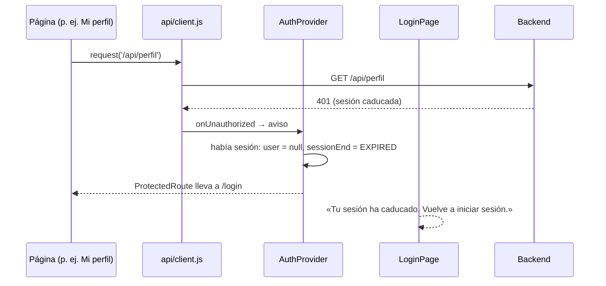

# HU43 · Cerrar sesión (Frontend)

Documento para entender cómo cierra el frontend la sesión de cada rol, cómo reacciona cuando el servidor la da por caducada y qué parte hace el backend.

- **Fecha:** 29 de octubre de 2026
- **HU:** HU43 · Cerrar sesión
- **Tasks:** AB#314 (clientes), AB#315 (vendedores), AB#316 (administradores) y AB#317 (lógica de borrado de cookies de sesión)
- **Rama:** `feature/US43-T314-T317-cerrar-sesion`
- **Metodología:** TDD; los commits `test(front-HU43): ciclo rojo` van antes que los `feat(front-HU43): ciclo verde`
- **Depende de:** el backend de la T318 (AB#318, PR #141) y la T319 (AB#319, PR #142), y `docs/hu2-login.md` (sesión y rutas protegidas)

---

## 1. Resumen

| Situación | Qué pasa |
|---|---|
| El usuario pulsa **Cerrar sesión** (cabecera, para los tres roles) | Se llama a `POST /api/auth/logout`, se cierra la sesión del navegador y se va a `/login` con el aviso **«Has cerrado sesión.»**. |
| El servidor no responde al cerrar sesión | La sesión del navegador se cierra igualmente, con el mismo aviso. |
| La sesión caduca en el servidor (15 minutos sin actividad, T319) | La siguiente petición recibe 401: el frontend cierra la sesión y las rutas protegidas llevan a `/login`, con el aviso **«Tu sesión ha caducado. Vuelve a iniciar sesión.»**. |
| Contraseña incorrecta en el login (también 401) | No es una sesión caducada: no había sesión abierta, así que no se avisa de nada más. |

Decisiones:

- **Destino tras cerrar sesión:** el backend responde 204 sin redirección, así que se va al login con un aviso (antes se iba a la página de inicio sin decir nada).
- **Sin confirmación** al cerrar sesión: el backend no la pide y no se pierde nada.

---

## 2. Las cookies

- **`JSESSIONID`** es `HttpOnly`: el JavaScript del frontend **no puede leerla ni borrarla**. La borra el servidor al cerrar sesión (`deleteCookies("JSESSIONID")` en `SecurityConfig`, HU43-CP01).
- **`XSRF-TOKEN`** también la gestiona el servidor (Spring Security la renueva al cerrar sesión).
- Por eso la «lógica de borrado» del frontend (T317) consiste en:
  - pedir el cierre al servidor;
  - borrar el estado en memoria: usuario y, con él, el carrito, que va ligado al cliente en sesión;
  - reaccionar a la caducidad.

  El frontend no guarda nada en `localStorage` ni en `sessionStorage`.

---

## 3. Flujo de la caducidad

---

## 4. Archivos

| Archivo | Cambio |
|---|---|
| `src/api/client.js` | `onUnauthorized(handler)`: avisa de cada respuesta 401 y devuelve cómo dejar de escuchar. |
| `src/auth/AuthContext.js` | `SESSION_END` (`SIGNED_OUT` y `EXPIRED`): por qué terminó la última sesión. |
| `src/auth/AuthProvider.jsx` | Guarda `sessionEnd`; escucha los 401 y, si había sesión, la cierra como caducada. `signIn` borra el motivo. |
| `src/components/AppHeader.jsx` | **Cerrar sesión** lleva a `/login` cuando termina. |
| `src/pages/LoginPage.jsx` | Muestra el aviso según `sessionEnd`. |

---

## 5. Tests

Los casos siguen la numeración del backend (HU43-CP01 a CP03).

| Caso | Task | Qué se prueba | Archivo |
|---|---|---|---|
| HU43-CP04 | AB#314 | El cliente cierra sesión desde `/products`: llamada al servidor, login con aviso y su zona ya no es accesible | `AppHeader.test.jsx` |
| HU43-CP05 | AB#315 | Lo mismo para el vendedor desde `/seller/products` | `AppHeader.test.jsx` |
| HU43-CP06 | AB#316 | Lo mismo para el administrador desde `/admin` | `AppHeader.test.jsx` |
| HU43-CP07 | AB#317 | Un 401 avisa a quien escucha (y no otros errores); con la sesión caducada se vuelve al login con el aviso; una contraseña incorrecta no se toma por caducidad (4 tests) | `client.test.js` y `LoginFlow.test.jsx` |
| HU43-CP08 | AB#317 | Si el servidor falla al cerrar sesión, la sesión del navegador se cierra igualmente | `AppHeader.test.jsx` |

Se quitaron dos tests de la HU2 que esperaban volver a la página de inicio tras cerrar sesión; los nuevos los sustituyen.
