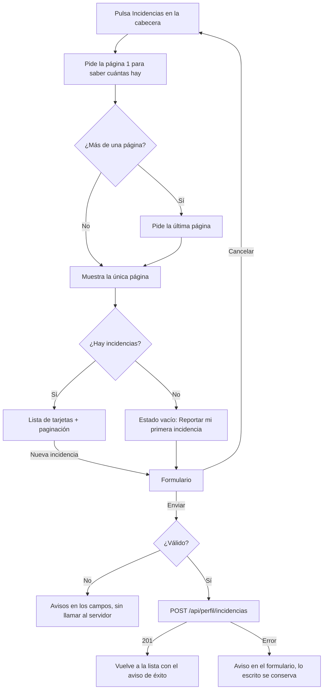

# HU44 · Creación de incidencias (Frontend)

Documento para entender cómo el cliente y el vendedor reportan una incidencia desde su perfil y consultan su estado y la respuesta del administrador: qué muestra cada vista, cómo fluye la información, qué hace cada componente, qué contrato espera del backend y cómo probarla.

- **Fecha:** 7 de noviembre de 2026
- **HU:** HU44 · Creación de incidencias (AB#266)
- **Tasks:** T289 (AB#289, vista de incidencias del cliente) y T290 (AB#290, vista de incidencias del vendedor). Es la misma vista para los dos roles.
- **Rama:** `feature/US44-T289-T290-incidencias-front`
- **Metodología:** TDD. Cada pieza tiene su commit de rojo (`test(front-HU44)`) antes del de verde (`feat(front-HU44)`).
- **Depende de:** el backend de la HU44 (T291, T293, T292 y T419, PR #224) y su contrato, `docs/contratos/hu44-incidencias.md`; `docs/hu2-login.md` (sesión y rutas protegidas).

---

## 1. Resumen

El cliente y el vendedor tienen un botón **Incidencias** en la cabecera que lleva a **Mis incidencias** (`/incidents`): una lista de tarjetas, como la de **Mis pedidos**, con sus incidencias, su estado y la respuesta del administrador. Desde ahí, **Nueva incidencia** abre el formulario (`/incidents/new`) para reportar una. La gestión por el administrador (responder, abrir y cerrar) es de las HU49 y HU50 y queda fuera de esta HU.

| Criterio de aceptación | Cómo se cumple |
|---|---|
| Los usuarios pueden reportar una incidencia (asunto y descripción) desde su perfil | Botón **Incidencias** en la cabecera y formulario `/incidents/new` (`NewIncidentPage` con `IncidentForm`). |
| El usuario ve el estado de sus incidencias y la respuesta del administrador | `IncidentsPage` con `IncidentsList`: una tarjeta por incidencia con su Estado (Pendiente o Abierta) y la Respuesta del administrador («Sin respuesta todavía» si aún no hay). |
| La gestión por el administrador es de las HU49 y HU50 | Fuera de alcance. El usuario no cierra ni elimina sus incidencias: no hay ningún botón para ello en su vista. |

---

## 2. Rutas

| Ruta | Página | Quién entra |
|---|---|---|
| `/incidents` | `IncidentsPage` | Cliente y vendedor |
| `/incidents/new` | `NewIncidentPage` | Cliente y vendedor |

Las dos van bajo `ProtectedRoute` con `[CLIENTE, VENDEDOR]`: sin sesión llevan al login y el administrador vuelve a su panel (el backend también le responde 403 `ACCESS_DENIED`). El botón **Incidencias** de `AppHeader` solo sale para esos dos roles.

---

## 3. Flujo

---

## 4. Archivos

| Archivo | Para qué |
|---|---|
| `src/api/incidents.js` | `getIncidents({ page, size })` y `createIncident({ asunto, descripcion })`. |
| `src/features/incidents/incidentRules.js` | Límites (asunto 100 y descripción 1000) y `validateIncident`, que no cuenta los espacios de los extremos. |
| `src/features/incidents/incidentStatus.js` | Etiqueta y color del estado: Pendiente (aviso) y Abierta (marca). |
| `src/features/incidents/IncidentsList.jsx` | La lista de tarjetas (`ul` con `Card`, como `OrdersPage`): asunto, fecha, estado, descripción y respuesta. |
| `src/features/incidents/IncidentForm.jsx` | El formulario: campos con contador, errores por campo y botones Enviar incidencia y Cancelar. |
| `src/pages/IncidentsPage.jsx` | Mis incidencias: carga, error, lista vacía, lista, paginación y aviso de éxito. |
| `src/pages/NewIncidentPage.jsx` | Crea la incidencia y vuelve a la lista con el aviso. |
| `src/components/AppHeader.jsx` | Botón **Incidencias** para cliente y vendedor. |
| `src/routes/paths.js` y `AppRoutes.jsx` | `INCIDENTS` e `INCIDENT_NEW`. |
| `src/utils/format.js` | `formatDateTime`: fecha y hora local en español, `DD/MM/AAAA, HH:MM`. |
| `src/mocks/incidentsHandlers.js` | Mocks del contrato (ver `docs/mocks-msw.md`). |

---

## 5. Contrato usado

Detalle completo en `docs/contratos/hu44-incidencias.md`.

| Petición | Respuesta |
|---|---|
| `GET /api/perfil/incidencias?page=1&size=10` | 200 `{ items, page, size, totalItems, totalPages }`. `page` desde 1, `size` de 1 a 50. De las más antiguas a las más recientes. Sin incidencias: `items` vacío y `totalPages` 0. |
| `POST /api/perfil/incidencias` con `{ asunto, descripcion }` | 201 `{ id, asunto, descripcion, estado, respuesta, fechaCreacion }`. 400 `VALIDATION_ERROR` con un mensaje genérico. |
| Cualquiera, sin sesión | 401 |
| Cualquiera, como administrador | 403 `ACCESS_DENIED` |

- Los POST llevan el token CSRF (`X-XSRF-TOKEN`): lo añade `api/client.js`.
- `respuesta` es `""` hasta que un administrador responde. `estado` es `PENDIENTE` o `ABIERTA`; no hay «cerrada», porque una incidencia cerrada se elimina (HU50).
- `fechaCreacion` es ISO-8601 en UTC: la tabla la muestra en la hora local del navegador.

---

## 6. Decisiones

- **Abre en la última página.** El backend ordena de las más antiguas a las más recientes, así que la primera página enseña lo más viejo. `IncidentsPage` pide la página 1 para saber cuántas hay y, si hay más de una, pide la última (una petición más solo en ese caso). Dentro de una página se respeta el orden del backend. Al crear una incidencia se vuelve a la lista, que abre en la última página, donde queda la nueva.
- **Sin botón de cerrar.** El usuario no cierra ni elimina sus incidencias (decisión del equipo): cerrarlas es solo del administrador, en la HU50. Por eso la vista no tiene ese botón, ni deshabilitado.
- **Sin botón de ordenar.** La lista llega de las más antiguas a las más recientes y se muestra así: el contrato no tiene ningún parámetro de orden y ordenar solo en el cliente dejaría las páginas mal cortadas (decisión del equipo).
- **Como los pedidos, no como una tabla.** Cada incidencia es una tarjeta (`Card`) de una lista, igual que en `OrdersPage`, y en pantallas estrechas el estado baja a una segunda línea. La descripción y la respuesta se muestran enteras.
- **Validación en el cliente con los límites del backend.** El contador cuenta lo escrito sin los espacios de los extremos, como el backend. «Obligatorio» se avisa al intentar enviar; pasarse del máximo, al momento. El backend responde 400 con un mensaje genérico, así que el formulario no puede saber qué campo falló: avisa en general y conserva lo escrito.
- **Errores al crear.** Un 400 avisa «Revisa el asunto y la descripción»; cualquier otro fallo (red, 401, 403, 500) avisa de la conexión. En los dos casos el formulario sigue abierto y se puede reenviar.
- **Misma vista para cliente y vendedor.** Lo específico del vendedor (AB#290) es que ve el botón y puede entrar y crear; el contrato es el mismo.
- **Sin estado activo en el botón de la cabecera:** ningún botón de `AppHeader` lo tiene hoy, así que no se añade solo a este.

---

## 7. Tests

Los casos siguen la numeración del backend (HU44-CP01 a CP22): el frontend empieza en el CP23 y llega al CP33 (el CP34 se descartó al quitar el botón de cerrar). Todos están pendientes de confirmar con el equipo.

| Caso | Task | Qué se prueba | Archivo |
|---|---|---|---|
| HU44-CP23 | AB#289 | Las llamadas de la API: `GET` con la página y el tamaño, `POST` con el asunto y la descripción, y los errores 400 y 403 | `incidents.test.js` |
| HU44-CP24 | AB#289 | Obligatorios, límites de 100 y 1000 y espacios de los extremos | `incidentRules.test.js` |
| HU44-CP25 | AB#289 | Etiqueta y color de cada estado y su badge en la lista | `incidentStatus.test.js`, `IncidentsList.test.jsx` |
| HU44-CP26 | AB#289 | Un elemento por incidencia, con asunto, fecha local, descripción entera y respuesta (o «Sin respuesta todavía»); sin botones y con `aria-busy` al recargar | `IncidentsList.test.jsx` |
| HU44-CP27 | AB#289 | Última página por defecto, paginación, una sola página, carga, error con reintentar y lista vacía | `IncidentsPage.test.jsx` |
| HU44-CP28 | AB#289 | Nueva incidencia (y reportar la primera) lleva al formulario | `IncidentsPage.test.jsx` |
| HU44-CP29 | AB#289 | Campos, contador, validación y envío sin espacios en los extremos; un formulario no válido no llama al servidor | `IncidentForm.test.jsx`, `NewIncidentPage.test.jsx` |
| HU44-CP30 | AB#289 | Crear con éxito: aviso y la incidencia aparece en la lista; botón deshabilitado al enviar | `NewIncidentPage.test.jsx` |
| HU44-CP31 | AB#289 | Un 400 y un error de red conservan lo escrito, reenviar y cancelar | `NewIncidentPage.test.jsx` |
| HU44-CP32 | AB#289 | El cliente ve el botón Incidencias en la cabecera y lleva a la vista | `AppHeader.test.jsx` |
| HU44-CP33 | AB#290 | El vendedor ve el botón y crea incidencias; el administrador y el invitado no lo ven y las rutas los redirigen | `AppHeader.test.jsx`, `NewIncidentPage.test.jsx` |

---

## 8. Pendiente

- **Responder, abrir y cerrar incidencias (administrador):** HU49 y HU50.
- **Cabecera en móvil:** a 375 px los botones de `AppHeader` no caben en una línea y la cabecera ensancha la página (ya pasaba con los botones del cliente antes de la HU44; el botón Incidencias suma unos 130 px). La vista de incidencias en sí no desborda. Arreglarlo es un cambio de la cabecera, fuera de esta HU: queda por consultar con el equipo.
- **Mocks y backend real:** los mocks de `incidentsHandlers.js` conviven con el backend del PR #224; no hay que quitarlos al mergearlo.
