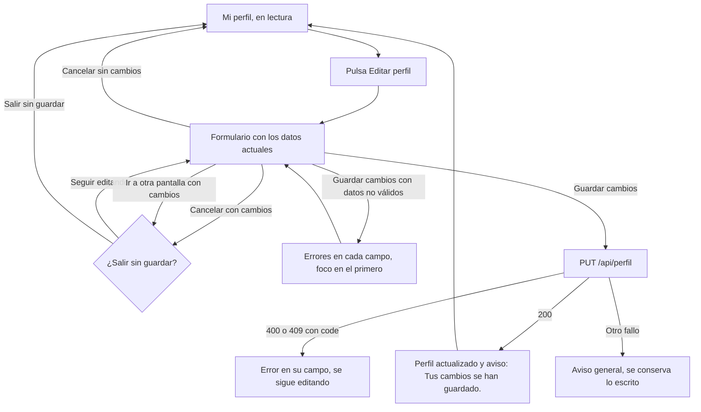

# HU45 · Edición de perfil (Frontend)

Documento para entender cómo el cliente y el vendedor editan su propio perfil: dónde está la opción, qué campos se pueden cambiar, cuándo se guarda, qué errores del backend se muestran y cómo se avisa de los cambios sin guardar.

- **Fecha:** 8 de noviembre de 2026
- **HU:** HU45 · Edición de perfil
- **Task:** T103 (AB#103) · Frontend: pantalla de edición de perfil
- **Rama:** `feature/US45-T103-pantalla-edicion-perfil`
- **Metodología:** TDD. Cada pieza tiene su commit de rojo (`test(front-HU45)`) antes del de verde (`feat(front-HU45)`); el cambio de router es un refactor aparte.
- **Depende de:** el endpoint del backend (T101, AB#101, PR #239: `PUT /api/perfil`), la vista de perfil (`docs/hu4-vista-perfil.md`) y la edición del administrador (HU22), de la que reutiliza el formulario.

---

## 1. Resumen

En **Mi perfil**, el botón **Editar perfil** convierte la tarjeta de datos en un formulario, en el mismo panel y sin cambiar de página. Solo se envía algo al pulsar **Guardar cambios**; el servidor responde con el perfil actualizado, que pasa a mostrarse, y un aviso confirma que se ha guardado. Si hay cambios sin guardar, se pregunta antes de cancelar, de ir a otra pantalla y de cerrar o recargar la pestaña.

| Criterio de aceptación | Cómo se cumple |
|---|---|
| El usuario edita sus datos modificables en el propio panel de perfil | `ProfilePage` muestra `ProfileEditor` (en modo `own`) en lugar de la rejilla de solo lectura. |
| Los cambios se aplican solo al pulsar guardar | El formulario solo llama a `updateProfile` al enviarse. Escribir, cancelar o salir no envía nada. |
| Mensaje de confirmación al guardar | Aviso «Tus cambios se han guardado.» dentro de una región `role="status"` que anuncia el lector de pantalla. |
| Aviso al salir con cambios sin guardar | `useUnsavedChangesGuard`: `useBlocker` para la navegación dentro de la aplicación y `beforeunload` para cerrar o recargar la pestaña. Solo si hay cambios reales. |

---

## 2. Flujo



---

## 3. Qué se puede editar

Son los datos que el backend deja modificar (decisión del 05/11, `docs/calidad/matriz-trazabilidad.md`, HU45). El resto se ve, pero en solo lectura.

| Rol | Editable | Solo lectura |
|---|---|---|
| Cliente | Nombre, apellidos, teléfono, fecha de nacimiento e imagen de perfil | Email, rol, DNI y tipo de cliente |
| Vendedor | Nombre, apellidos, nombre comercial, teléfono, categoría principal e imagen de perfil | Correo electrónico, rol y DNI |

La contraseña no se edita aquí (solo con «He olvidado mi contraseña»). El estado de la cuenta no aparece en el perfil propio.

---

## 4. Archivos

| Archivo | Cambio |
|---|---|
| `src/pages/ProfilePage.jsx` | Botón **Editar perfil**; muestra `ProfileEditor` en modo `own`; tras guardar, el perfil pasa a ser la respuesta del servidor y se avisa; usa el aviso de cambios sin guardar al cancelar y al navegar. |
| `src/api/profile.js` | Nueva `updateProfile(datos)`: `PUT /api/perfil`. |
| `src/features/admin/profileFields.js` | `profileFieldsFor`, `initialValues`, `validateProfile` y `profilePayload` aceptan `{ own: true }`: sin estado y con el DNI y el tipo de cliente en solo lectura. Sin la opción, todo funciona igual que en la HU22. |
| `src/features/admin/ProfileEditor.jsx` | Nuevas propiedades `own` y `onDirtyChange`. En modo `own`: botón «Guardar cambios», foco en el primer campo con error, `UNDERAGE` con su texto propio y `onSaved` recibe también la respuesta del servidor. |
| `src/features/account/registroErrors.js` | `erroresDelServidor(error, propios)` acepta cambiar el campo o el texto de un code en un formulario concreto. |
| `src/hooks/useUnsavedChangesGuard.js` | Nuevo. `useBlocker` y `beforeunload` solo si hay cambios. |
| `src/features/account/UnsavedChangesDialog.jsx` | Nuevo. Diálogo «¿Salir sin guardar?», con el foco en «Seguir editando». |
| `src/App.jsx` | Pasa a `createBrowserRouter` y `RouterProvider`, con una ruta comodín que monta `AppRoutes`. |
| `src/test/renderApp.jsx` | Pasa a `createMemoryRouter`, igual que la aplicación. |
| `src/mocks/profileHandlers.js` y `src/test/setup.js` | Mock de `PUT /api/perfil` con las reglas y los codes del backend; guarda lo editado hasta que se reinician los mocks. |

---

## 5. Contrato usado

`PUT /api/perfil` (T101, PR #239). Se envían **todos** los datos modificables del rol, porque el PUT los sustituye todos:

```json
{ "nombre": "Carla", "apellidos": "Cliente", "telefono": "611222333", "fechaNacimiento": "1998-05-14", "avatar": "avatar1" }
```

El vendedor envía `nombreComercial` y `categoriaPrincipalId` en lugar de `fechaNacimiento`. El email, el DNI, el tipo de cliente y el rol no viajan nunca. Un teléfono vacío se envía vacío: el backend lo guarda como «sin teléfono».

| Respuesta | Cuándo | Qué hace el frontend |
|---|---|---|
| 200 con el perfil actualizado (misma forma que `GET /api/perfil`) | Datos correctos | Muestra ese perfil, vuelve a la lectura y avisa. |
| 400 `INVALID_PHONE` | El teléfono no tiene 9 números | Error en el campo «Teléfono». |
| 400 `UNDERAGE` | Cliente menor de edad | Error en «Fecha de nacimiento»: «Debe ser mayor de edad». |
| **409** `COMMERCIAL_NAME_ALREADY_REGISTERED` | Nombre comercial de otro vendedor | Error en «Nombre comercial». |
| 400 `VALIDATION_ERROR` | Forma incorrecta (sin campo concreto) | Aviso general; se conserva lo escrito. |
| 401 | Sin sesión | El cliente HTTP ya trata el 401 como sesión caducada (HU43). |
| 403 `ACCESS_DENIED` | Administrador | No tiene perfil; la ruta no se lo permite. |

Nunca se muestra el texto del backend: cada code tiene su mensaje. El nombre comercial repetido responde **409**, no 400; `erroresDelServidor` ya trata los dos.

---

## 6. Decisiones

- **Mismo panel, no página nueva.** «Editar perfil» cambia lo que muestra la tarjeta del perfil. La cabecera, las preferencias y la eliminación de la cuenta no cambian.
- **Se reutiliza el formulario de la HU22.** `ProfileEditor` ya tenía los campos, la validación, el selector de imagen, el de categoría y la traducción de errores del backend. Un modo opcional `own` evita duplicarlo; sin él, el administrador ve exactamente lo de antes.
- **El mensaje de `UNDERAGE` cambia en este formulario.** El texto compartido habla de «registrarte». Aquí se usa «Debe ser mayor de edad», el mismo de la validación en el cliente. El registro y la HU22 no cambian.
- **Router de datos.** `useBlocker` solo funciona con un router de datos. `App.jsx` y `renderApp` pasan a `createBrowserRouter` y `createMemoryRouter`, con una ruta comodín que monta `AppRoutes`, que sigue declarando todas las rutas. Es un refactor sin cambios de comportamiento: se hizo en su propio commit y los 1393 tests existentes pasaron sin tocarlos.
- **Solo se avisa si hay cambios reales.** El formulario compara sus valores con los iniciales: si se escribe algo y después se vuelve a lo que había, ya no hay cambios. Tampoco se avisa tras guardar.
- **Solo se bloquea cambiar de ruta.** Ir al mismo `pathname` no pregunta. Cerrar sesión con cambios sin guardar también pregunta, porque lleva a otra ruta.
- **Al cerrar o recargar la pestaña, el texto lo pone el navegador.** Los navegadores no permiten personalizarlo; `beforeunload` solo pide la confirmación.
- **El diálogo propone lo seguro por defecto.** El foco empieza en «Seguir editando» y Escape lo elige. Es el mismo diálogo para cancelar y para navegar.
- **Foco al primer error.** Al intentar guardar con errores, el foco va al primer campo inválido. Los errores se enlazan con su campo (`aria-describedby`, de `Field` de Fluent).
- **La cabecera no cambia.** No muestra el nombre ni la imagen del usuario (`useAuth().user` solo se usa para el rol), así que no hay nada que refrescar tras guardar. No se ha añadido nada a `AuthProvider`.
- **Mocks.** El `PUT` aplica el mismo orden de validación que el backend (forma, teléfono, mayoría de edad, nombre comercial único) y el `GET` devuelve lo editado hasta que se reinician los mocks.

---

## 7. Tests

Los casos siguen la numeración del backend (HU45-CP01 a CP10): el frontend empieza en el CP11. Todos están pendientes de confirmar con el equipo.

| Caso | Qué se prueba | Archivos |
|---|---|---|
| HU45-CP11 | Cliente y vendedor ven sus datos modificables como campos editables en el propio panel y el email, el DNI, el tipo de cliente y el rol en solo lectura; sin estado | `profileFields.test.js`, `ProfileEditor.test.jsx`, `ProfilePage.test.jsx` |
| HU45-CP12 | Guardar envía todos los datos del rol, el botón se deshabilita mientras tanto, se avisa y se muestra lo guardado; sin pulsar guardar no se envía nada | `profileFields.test.js`, `ProfileEditor.test.jsx`, `ProfilePage.test.jsx` |
| HU45-CP13 | Con datos no válidos no se envía nada, cada error sale en su campo y el foco va al primero | `profileFields.test.js`, `ProfileEditor.test.jsx`, `ProfilePage.test.jsx` |
| HU45-CP14 | Cada code del backend sale en su campo con su mensaje; `VALIDATION_ERROR` y los fallos del servidor, aviso general sin detalles | `registroErrors.test.js`, `ProfileEditor.test.jsx`, `ProfilePage.test.jsx` |
| HU45-CP15 | El formulario avisa de si hay cambios; Cancelar descarta y, si los hay, pregunta antes | `ProfileEditor.test.jsx`, `ProfilePage.test.jsx` |
| HU45-CP16 | Aviso al ir a otra pantalla y al cerrar o recargar la pestaña, solo con cambios; el diálogo | `useUnsavedChangesGuard.test.jsx`, `UnsavedChangesDialog.test.jsx`, `ProfilePage.test.jsx` |

Cambia también el test HU4-CP05 «los datos del perfil son de solo lectura»: ya no afirma que no hay ningún botón «guardar|editar» (ahora hay «Editar perfil»), sino que no hay «guardar» en la lectura; los campos siguen siendo de solo lectura.

Los dos archivos de test nuevos (`useUnsavedChangesGuard.test.jsx` y `UnsavedChangesDialog.test.jsx`) corresponden a las dos piezas nuevas. `updateProfile` no tiene archivo de test propio (`api/profile.js` tampoco lo tenía): lo cubren los tests de la página y del formulario.

---

## 8. Pendiente

- **Matriz:** rellenar el número de este PR (`PR pendiente`) y pasar los tests de 🔍 a ✅ al mergear.
- **Casos de prueba:** HU45-CP11 a CP16 están propuestos y pendientes de confirmar con el equipo.
- **Textos del backend:** los mensajes de los errores hablan de «registro»; el frontend no los usa y se guía por el `code`.
- **Cabecera en móvil:** a 375 px la cabecera con todos sus enlaces ya es más ancha que la pantalla (hay desplazamiento horizontal). No es de esta HU y no se ha tocado.
