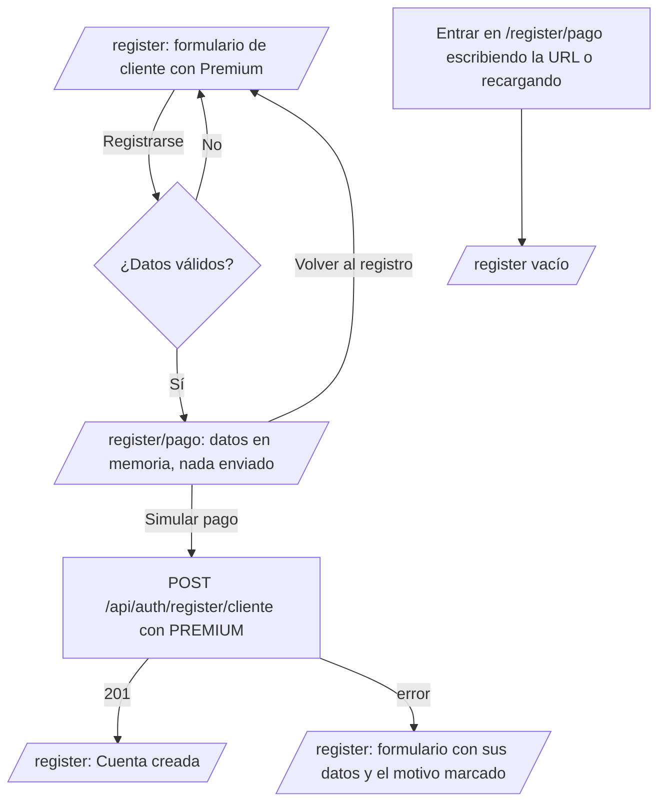
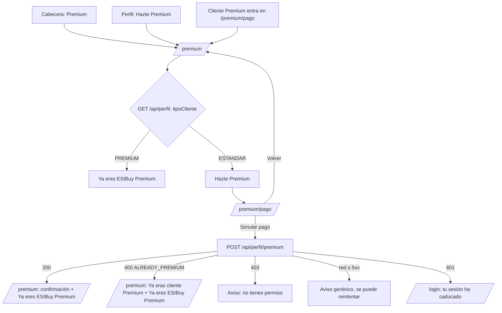

# HU45 · ESIBuy Premium: registro con pasarela y vista de ventajas (Frontend)

Documento para entender cómo se hace un cliente ESIBuy Premium desde el frontend: la pasarela de pago simulada obligatoria al registrarse como Premium, la vista de ventajas Premium y el paso a Premium de un cliente Estándar.

- **Fecha:** 8 de noviembre de 2026
- **HU:** HU45 · Edición de perfil (AB#267)
- **Tasks:** AB#420 (pasarela de pago simulada al registrarse como Premium) y AB#421 (vista de ventajas Premium y acceso desde la cabecera y el perfil)
- **Rama:** `feature/US45-T420-T421-premium-front`
- **Metodología:** TDD (commit de rojo `test(front-HU45)` y de verde `feat(front-HU45)` por task)
- **Backend:** `POST /api/perfil/premium` es de las tasks **T422 y T423** del backend, que se desarrollan en paralelo. Mientras tanto, el frontend usa el mock de MSW (sección 5).
- **Casos de prueba:** HU45-CP21 a HU45-CP35 (los CP01 a CP10 y CP17 a CP20 son del backend; CP11 a CP16, del frontend de la edición del perfil, T103). Ver `docs/calidad/matriz-trazabilidad.md`.

---

## 1. Resumen

| Qué se pidió | Cómo se cumple |
|---|---|
| Registrarse como Premium obliga a pasar por una pasarela | Con «Premium» elegido, «Registrarse» valida el formulario y lleva a `/register/pago` **sin enviar nada** |
| La pasarela solo simula el pago | `PremiumCheckout`: resumen «ESIBuy Premium» con sus tres ventajas, **sin precio** y sin campos de tarjeta; «Simular pago» y un botón para volver |
| Tras simular el pago se registra como Premium | «Simular pago» envía `POST /api/auth/register/cliente` con `tipoCliente: 'PREMIUM'` y vuelve al registro con el mismo «Cuenta creada» que el registro Estándar |
| No se puede saltar la pasarela | El único código que envía el registro como PREMIUM es `pagarYRegistrar` del flujo, que solo llama «Simular pago». Sin datos en memoria, `/register/pago` vuelve al registro vacío |
| Cancelar vuelve al formulario con sus datos | «Volver al registro» recupera el formulario tal como estaba; se puede cambiar a Estándar (se registra directo) o reintentar |
| Los datos no salen de la memoria | El formulario (contraseña incluida) vive solo en el estado de React de `RegistroPremiumFlow`: nunca en la URL, la query string, `localStorage` ni `sessionStorage`. Al recargar se pierden |
| Botón «Premium» en la cabecera | Solo para el rol CLIENTE, con el icono de diamante; lleva a `/premium` |
| Botón «Hazte Premium» en el perfil | Solo para el cliente Estándar; el Premium ve el distintivo «Premium» |
| Vista de ventajas | `/premium`: titular con brillo animado, tres tarjetas con entrada escalonada y elevación al pasar por encima. Sin precio |
| Paso a Premium | «Hazte Premium» → `/premium/pago` (la misma pasarela) → `POST /api/perfil/premium` → vuelve a `/premium` con la confirmación y en estado «Ya eres ESIBuy Premium» |

---

## 2. Flujos

### 2.1 Registro como Premium (T420)

- La pasarela y el formulario están bajo la misma ruta de layout `RegistroPremiumFlow` (dentro de `GuestOnlyRoute`): al salir del registro, el estado se descarta.
- Al simular el pago o cancelar se navega con `replace`: la pasarela no se queda en el historial, así que el botón atrás no vuelve a ella.
- Si el servidor rechaza el registro después del pago, se vuelve al formulario con el error. Para volver a intentarlo como Premium hay que pasar otra vez por la pasarela.

### 2.2 Paso a Premium del cliente Estándar (T421)

- El aviso de vuelta a `/premium` va en el estado de la navegación (`location.state.aviso`), nunca en la URL.
- Tras el paso a Premium se vuelve a pedir el carrito (`useCart().reload()`), porque sus precios dependen del tipo de cliente. El perfil y los precios del catálogo se piden al servidor cada vez que se abren, así que reflejan Premium sin recargar.
- `GET /api/auth/me` no incluye el tipo de cliente: la vista Premium y la pasarela lo toman de `GET /api/perfil`.
- Nunca se muestra el texto que envía el backend: los mensajes se eligen por el estado y el `code`.

---

## 3. Componentes y archivos

| Archivo | Qué hace |
|---|---|
| `features/premium/PremiumCheckout.jsx` | La pasarela simulada de ESIBuy Premium, con el aspecto de la del carrito (HU10). La usan las dos pasarelas |
| `features/premium/premiumBenefits.js` | Las tres ventajas (título, texto e icono) |
| `features/premium/premiumNotices.js` | Los avisos con los que la pasarela vuelve a la vista Premium |
| `features/account/RegistroPremiumContext.js` | Contexto y `useRegistroPremium()` |
| `features/account/RegistroPremiumFlow.jsx` | Ruta de layout que guarda en memoria los datos del registro y envía el registro PREMIUM tras «Simular pago» |
| `features/account/accountRules.js` | `sinTelefonoVacio` (antes en `Register.jsx`), que usan el registro y el flujo |
| `pages/Register.jsx` | Con Premium, lleva a la pasarela en vez de enviar; al volver recupera los datos y el resultado |
| `pages/RegisterPaymentPage.jsx` | `/register/pago` |
| `pages/PremiumPage.jsx` | `/premium` (solo CLIENTE) |
| `pages/PremiumPaymentPage.jsx` | `/premium/pago` (solo CLIENTE) |
| `components/AppHeader.jsx` | Botón «Premium» del cliente |
| `pages/ProfilePage.jsx` | «Hazte Premium» o el distintivo «Premium» del cliente |
| `api/profile.js` | `becomePremium()` |
| `mocks/profileHandlers.js` | `POST /api/perfil/premium` simulado y `resetProfileMock` |

---

## 4. Accesibilidad y animaciones

- Un único `h1` por vista; las ventajas son una lista con `h3` bajo el `h2` «Ventajas de ESIBuy Premium».
- La confirmación del paso a Premium aparece en una región `aria-live="polite"`.
- Todo se maneja con teclado: los accesos son enlaces y botones de Fluent, con su foco visible.
- Las animaciones son de CSS con `makeStyles` (Griffel), sin dependencias nuevas: entrada escalonada de las tarjetas (120 ms entre una y otra), degradado animado en el fondo del titular, brillo que recorre el texto «ESIBuy Premium», icono flotante y elevación al pasar por encima. Con `prefers-reduced-motion: reduce` no hay animación ni desplazamiento. Con colores forzados, el titular usa el color del sistema.
- La rejilla de ventajas es de una columna en móvil (375 px) y de tres desde 720 px.

---

## 5. Contrato del backend (tasks T422 y T423)

`POST /api/perfil/premium`, sin cuerpo. Solo para el rol CLIENTE sobre sí mismo (el backend lo deduce de la sesión). Lleva el token CSRF como el resto de peticiones que cambian datos (`api/client.js`).

| Respuesta | Cuándo | Qué hace el frontend |
|---|---|---|
| 200 con el `PerfilResponse` (`id`, `nombre`, `apellidos`, `email`, `rol`, `fechaAlta`, `dni`, `telefono`, `avatar`, `fechaNacimiento`, `tipoCliente`, `nombreComercial`, `categoriaPrincipalId`) con `tipoCliente: 'PREMIUM'` | Era Estándar | Vuelve a `/premium` con «¡Bienvenido a ESIBuy Premium! Ya disfrutas de sus ventajas.» |
| 400 `{ mensaje, code: 'ALREADY_PREMIUM' }` | Ya era Premium | Vuelve a `/premium` con «Ya eras cliente ESIBuy Premium: no hacía falta pagar.» y en estado Premium |
| 403 `{ mensaje: 'Acceso denegado', code: 'ACCESS_DENIED' }` | No es cliente | «No tienes permiso para realizar esta operación.» |
| 401 | Sin sesión | Se cierra la sesión del navegador y el login avisa de que ha caducado (HU43) |
| Error de red o 5xx | — | «No se ha podido completar el pago. Inténtalo de nuevo más tarde.» y se puede reintentar |

El mock (`mocks/profileHandlers.js`) responde igual: Nora (`nuevo@esibuy.test`) es Estándar y pasa a Premium; Carlos (`cliente@esibuy.test`) ya es Premium y recibe `ALREADY_PREMIUM`; los vendedores, 403. El cambio se deshace al reiniciar los mocks (`resetProfileMock`, en `test/setup.js`).

---

## 6. Riesgos conocidos

- **El backend acepta PREMIUM en el registro directo.** La pasarela obligatoria es una garantía del flujo en el cliente: `POST /api/auth/register/cliente` sigue admitiendo `tipoCliente: 'PREMIUM'` sin ningún pago, así que se puede saltar llamando a la API directamente. Cerrarlo es tarea del backend.
- **El pago es simulado:** no hay cobro ni precio. Si se define un precio, habrá que añadirlo al resumen de `PremiumCheckout`.
